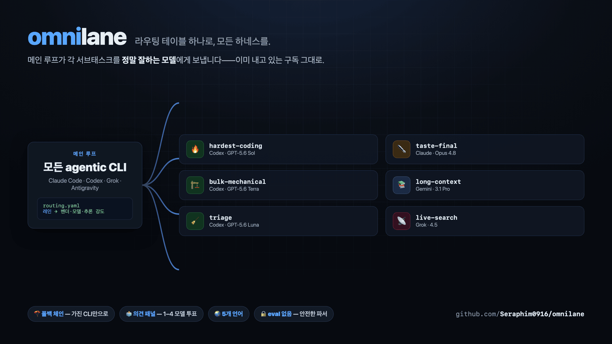
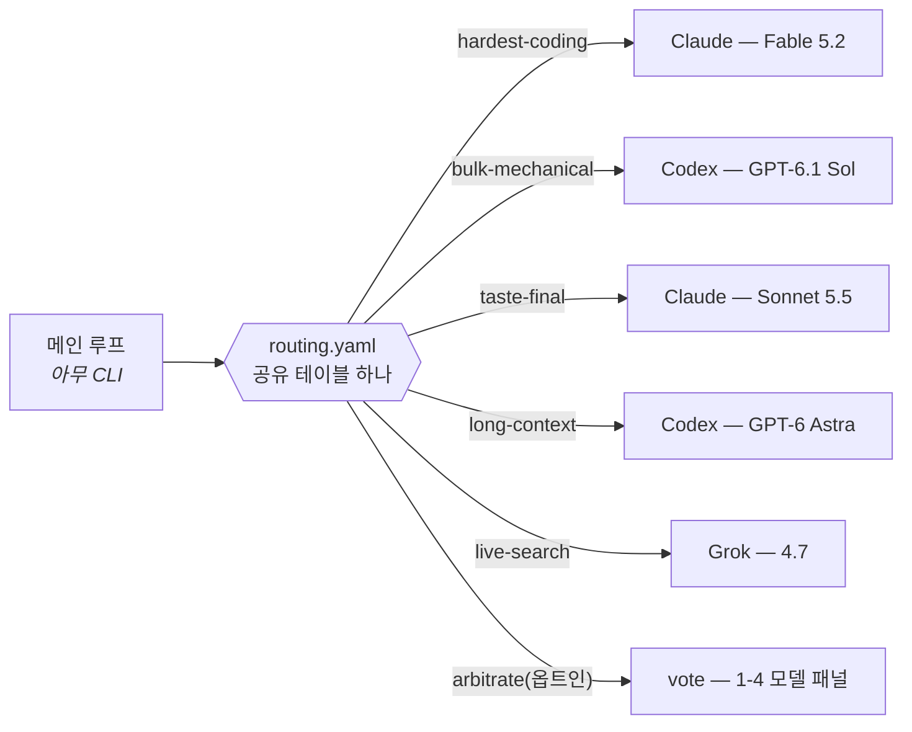
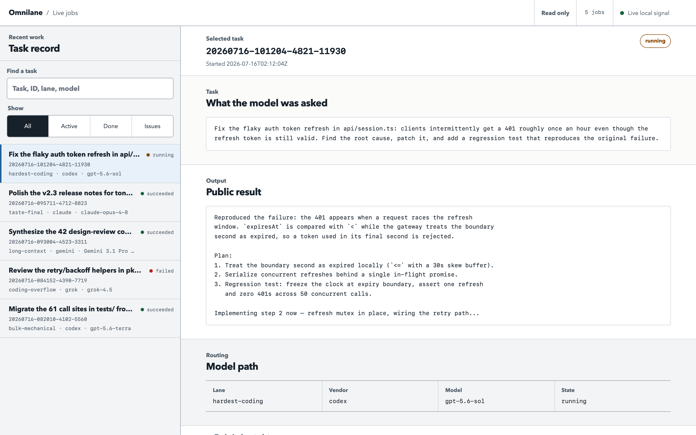
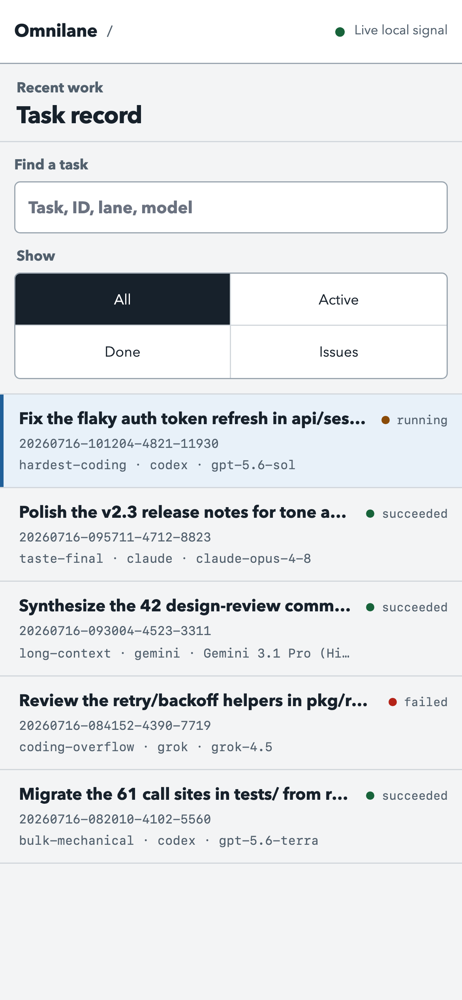

<div align="center">

# omnilane



[](https://github.com/Seraphim0916/omnilane/actions/workflows/ci.yml)
[](LICENSE)
[](https://github.com/Seraphim0916/omnilane/tags)

[English](README.md) · [繁體中文](README.zh-TW.md) · [简体中文](README.zh-CN.md) · [日本語](README.ja.md) · **한국어**

</div>

## omnilane이란?

omnilane은 Claude Code, Codex, Grok Build, Antigravity의 작업을 작업 종류에 따라 레인에 지정된 모델로 보냅니다. 기존 모델 구독이나 지원 API를 하나의 명령 체계로 사용하면서 권한과 결과를 직접 확인하려는 사용자와 AI 어시스턴트를 위한 도구입니다. 별도의 호스팅 서비스 대신 로컬 라우팅 표와 검증된 모델 선택자를 사용해 호환되는 네이티브 하위 에이전트 또는 벤더 CLI를 실행합니다.

## 설치와 첫 실행

지원 벤더 CLI(`codex`, `claude`, `grok`, `agy`)를 하나 이상 설치하고 로그인한 뒤, Python 3.9+와 npm을 준비하세요. 아래 블록은 로그인 정보에 접근할 수 있는 데스크톱 터미널에서 사람이 직접 실행하는 절차입니다. 초기화는 벤더를 탐색하고 실제 작업을 보내 검증하므로 벤더 사용량을 소비합니다. 작업 문구는 바꿔도 되며, 첫 작업은 읽기 전용입니다.

```bash
npm i -g omnilane &&
omnilane resign --init &&
omnilane doctor &&
export OMNILANE_AA_OPERATOR_ASSERTED_HUMAN=1 &&
omnilane route --mode advise --workdir "$PWD" triage "파일을 변경하지 말고 이 프로젝트의 용도를 요약하세요"
```

초기화가 성공하고 doctor에서 필요한 대상이 사용 가능하다고 확인된 뒤 디스패치를 계속하세요. `--init`은 최초 로컬 오버레이(CLI 선택자가 실제로 어떤 모델에 도달하는지 보여 주는 검증 기록)를 만들고 검증한 다음, 최초 신뢰 서명자를 기록하고 `local.sh`를 백업한 후 등록합니다. 기존 오버레이가 있으면 거절하므로 업그레이드 시에는 `omnilane resign`을 사용하세요. 초기화에는 대화형 터미널이 필요하며, 변경되었거나 안전하지 않은 서명자를 승인할 수 없습니다. 로컬 자체 서명 CLI는 사람이 별도로 검토해야 합니다.

이 환경 변수는 **터미널을 직접 조작하는 사람이라는 선언**입니다. AI 어시스턴트는 자신의 호출자 정보를 사용해야 하며, 이 변수나 `--operator-asserted-human`을 스스로 지정하면 안 됩니다. 설정 방법은 뒤의 참고 자료에 있습니다. 모든 벤더가 필요한 것은 아닙니다. 사용할 수 없는 후보는 건너뛰며, 호출자의 점수 상한과 로컬 검증도 적용됩니다.

## 일상적인 사용

`omnilane list`로 현재 적용되는 레인을 확인하세요. 초기 조사에는 `triage`, 반복 구현에는 `bulk-mechanical`, 어려운 코드 문제에는 `hardest-coding`, 다른 관점의 검토에는 `hard-judgment`를 사용합니다. 전체 레인 표는 참고 자료에 있습니다. 레인은 후보의 순서이며, 모든 모델의 설치나 프로바이더 호출 실패 후 다른 벤더로 자동 재시도하는 동작을 보장하지 않습니다.

```bash
omnilane list
omnilane route --mode advise --workdir "$PWD" triage "프로젝트를 검토하고 주요 위험을 나열하세요"
omnilane route --mode work --workdir "$PWD" bulk-mechanical "README.md에서 지적된 오타를 수정하세요"
omnilane route --background --mode work --workdir "$PWD" bulk-mechanical "테스트를 실행하고 실패 항목을 수정하세요"
omnilane jobs list
omnilane jobs wait JOB_ID --timeout 60
omnilane jobs result JOB_ID
```

`JOB_ID`를 백그라운드 디스패치가 출력한 작업 ID로 바꾸세요. `advise`는 읽기 전용이고, `work`는 지정한 작업 디렉터리의 변경을 허용하면서 에이전트 도구의 네트워크 접근을 제한합니다. 모델 연결은 유지됩니다. `jobs wait`는 종료를 기다리고 `jobs result`는 답변을 읽습니다. 종료된 작업도 출력, 변경 파일, 관련 테스트를 검토한 뒤 받아들여야 합니다. 어시스턴트 자체 네이티브 워커는 참고 자료에 있는 별도의 인계 및 완료 보고 절차를 따릅니다.

## 거절되거나 재서명이 멈췄을 때

거절 메시지는 이제 `omnilane: refused (...)`, 이해하기 쉬운 이유, `Next:`를 먼저 보여 주고 기존 JSON을 이어서 출력합니다. 이전 출력 형식이 필요한 스크립트는 `OMNILANE_REFUSAL_JSON_ONLY=1`을 설정하세요. 먼저 `failed_gate`, `reason`, `next_command`, `eligible_lanes`를 읽으세요. 재서명 요약에는 조치가 필요한 벤더별 이유와 다음 명령을 담은 `attention` 목록도 있습니다. `installed: true`는 검증된 변경이 설치되었다는 뜻이며 모든 행이 준비되었다는 뜻은 아닙니다.

표의 `VENDOR`와 `MODEL`은 진단에 표시된 이름으로 바꾸세요. `whoami`는 하나의 도구 호출에서 단독으로 실행하고, 파이프나 `&&`, 뒤에 붙인 명령을 사용하지 마세요.

| 표시 내용 | 의미 | 다음 명령 |
|---|---|---|
| `missing-caller-context` / `caller-identity` | 어시스턴트를 시작한 모델 또는 추론 강도를 읽을 수 없습니다. | `omnilane whoami` |
| 호출자 모델／강도의 점수 행이 없음 | 일반 레인 라우팅에는 정확히 일치하는 점수 쌍이 필요합니다. 지원되는 네이티브 워커는 실제 호출자 실행 환경을 상속할 수 있지만, 레인의 모델 목표를 충족한 것으로 보지는 않습니다. | `omnilane native-context --vendor VENDOR --model MODEL --inherits-caller-runtime --workdir "$PWD"` 후 참고 자료의 `--inherit` 인계 사용 |
| `target-above-effective-ceiling` | 대상이 호출자의 허용 점수를 초과합니다. 거절 메시지의 사용 가능한 레인을 확인하세요. | `omnilane route --explain hardest-coding` |
| `runtime-mapping-unverified` 또는 CLI 증거 변경 | 이 호스트에서 선택자가 검증되지 않았거나 실행 파일이 바뀌었습니다. | `omnilane resign --vendor VENDOR` |
| 종료 코드 2: 오버레이 미설정 | 최초 설정이 끝나지 않았습니다. | `omnilane resign --init` — 사람이 대화형 데스크톱 터미널에서 실행 |
| 종료 코드 20: `needs-login-session` | CLI가 로그인되지 않았거나 프로세스가 데스크톱 로그인에 접근할 수 없습니다. 먼저 데스크톱 터미널에서 로그인하세요. | `omnilane resign --vendor VENDOR` — 해당 로그인된 터미널에서 실행 |
| 종료 코드 20: `cli-not-installed` / `review-executable-source` | CLI가 없거나 실행 파일 출처／서명 검토가 필요합니다. 승인으로 잘못된 서명을 복구할 수는 없습니다. | `omnilane doctor` 후 벤더별 안내 따르기 |
| 종료 코드 20: `provider-verification-incomplete` / `verification-needed` | 검증이 미완료입니다. 표시된 API, 할당량, 네트워크 또는 미탐색 행의 원인을 먼저 해결하세요. | `omnilane resign --vendor VENDOR` |
| 환경 오류가 대기 시간／리셋 시각까지 보류됨 | 일반 실패 행은 명시적으로 재시도할 수 있습니다. 무인 재확인 대기 행에는 횟수 제한과 리셋 시각이 계속 적용됩니다. | `omnilane resign --retry-failed --vendor VENDOR` — 원인을 해결한 뒤 실행 |
| `deterministic-probe-failure`／모델 또는 강도 불일치 | 요청과 관측 결과가 다릅니다. `--retry-failed`를 사용해도 자동 재시도하지 않습니다. | `omnilane doctor`로 조사하고 CLI／프로바이더 매핑을 수정한 뒤 새로 검증 |
| 종료 코드 60: `partially-re-signed` | 통과한 선택자는 설치되었습니다. 보존된 행은 재확인 대기 중이며 디스패치할 수 없습니다. 종료 코드 20에 해당하는 보류가 우선합니다. | `omnilane resign --vendor VENDOR` — 대기 원인이 해결된 뒤 실행 |
| 종료 코드 20: `operator-or-login-needed`, 또는 다음 단계에 `--approve`, `--allow-shrink`, `--record-signers` 또는 신뢰／철회 플래그가 있음 | 운영자의 판단 사항이며 어시스턴트가 자신을 승인할 수 있다는 뜻이 아닙니다. | `omnilane doctor` — 사람이 증거를 검토하고 지정된 동작을 터미널에서 실행 |

## v0.61.0 새 기능

- **업그레이드 후 각 호스트에서 `omnilane resign`을 한 번 실행하세요.** 변경되지 않은 선택자 증거는 이어서 사용하며, 새 행과 변경된 행은 검증이 필요합니다. 종료 코드 **60**은 통과한 행은 설치되었고 나머지는 재확인 대기 중이라는 뜻입니다. `omnilane doctor`로 확인하고 원인이 해결된 뒤 재시도하세요.
- 승인된 AA Intelligence Index **v5.0.1** 스냅샷에 **Claude Fable 5.2**(Claude Code **2.1.321+** 필요)가 추가되어 `hardest-coding`과 `hard-judgment`의 첫 후보가 되었습니다. `long-context`는 GPT-6 Astra medium으로 시작합니다. 명시적인 네이티브 모델／강도 행도 현재 점수가 있어야 합니다. 철회된 쌍을 `native-rows.json`에서 제거하거나 지원되는 상속 워커를 사용하세요.
- 최초 설정은 `omnilane resign --init`으로 수행합니다. 거절에는 쉬운 다음 단계가, 종료 코드 20에는 벤더별 `attention` 안내가 제공됩니다. doctor／overlay-health는 이어서 사용하는 행과 신규／미탐색 행의 수를 보여 줍니다.
- 일부 프로바이더 검증이 실패해도 통과한 선택자는 사용할 수 있습니다. 무인 재확인은 횟수 제한과 리셋 시각을 지키며, 모델 불일치는 확정 실패로 처리합니다. 전체가 미인증인 스윕은 첫 탐색에서 멈춰 같은 로그인 실패를 반복하지 않습니다.
- 업그레이드: `npm i -g omnilane@0.61.0`.

## 📜 릴리스 기록

## v0.60.1 새 기능

- 이번 릴리스는 `omnilane resign`이 필요 없습니다. AA 스냅샷, 정책 파일, 레인은 바뀌지 않았습니다. SKILL.md가 바뀌었으므로(Claude Code에서 백그라운드로 `jobs wait`를 실행하는 방법) 모든 서피스에 스킬을 다시 배포하세요.
- 프롬프트 잘라내기가 더 이상 UTF-8 문자를 쪼개지 않습니다. 앞뒤 자르는 위치를 문자 경계로 옮기므로 큰 중국어 작업도 올바른 UTF-8로 남습니다. 마커는 `original`, `cap`, `dropped` 바이트 수를 보여 주고, 잘라낼 때 stderr에 경고를 출력합니다. 상한은 바뀌지 않았습니다.
- `jobs wait --json`은 wait에 JSON 모드가 없다고 알리고 지원하는 형식을 안내합니다. 대기 프로세스가 SIGTERM, SIGHUP, SIGINT로 멈추면 대기만 중단되었고 작업은 계속 실행 중이라고 알립니다. 종료 코드는 바뀌지 않았습니다.
- `jobs close`의 종료 영수증 대기는 단조 시계로 재므로 시스템 시계가 바뀌어도 일찍 끝나거나 늘어나지 않습니다.
- origin 정책 읽기는 파일 디스크립터를 명시적으로 관리합니다. 한 번만 닫고, 닫기 오류가 원래 실패를 가리지 않습니다.
- 업그레이드: `npm i -g omnilane@0.60.1`.

## v0.60.0 새 기능

- 이번 릴리스 자체로는 `omnilane resign`이 필요 없습니다. AA 스냅샷과 레인은 바뀌지 않았습니다. 모든 서피스가 새 SKILL.md를 읽도록 스킬을 다시 배포하세요.
- `jobs cancel`과 작업 전체 `--job-timeout`은 프로세스 그룹을 벗어난 작업 프로세스(예: `setsid`로 시작된 것)도 중지합니다. 작업의 `OMNILANE_JOB_TOKEN` 환경 변수 항목으로 대조하며 `jobs --json status`는 `leftovers`를 보고합니다. 작업 안에서 시작한 디스패치는 더 이상 그 작업의 마커를 물려받지 않습니다.
- 모든 JSON 읽기는 256단계를 넘는 중첩을 명시적 검사로 거부하므로 Python 3.9부터 3.14까지 결과가 같습니다. `aa_retry`는 깊은 입력에서 더 이상 충돌하지 않습니다.
- 러너 수정: 호출별 감시 프로세스는 기한 이후에도 자식이 실행 중인 것을 본 경우에만 142를 반환하고, 그 외에는 자식의 종료 코드를 유지합니다. Gemini(agy) 호출은 `--timeout`으로 제한되고, Grok은 종료 코드 125에서 재시도하지 않습니다.
- SKILL.md에 레인 후보를 확인할 때 로컬 재정의가 우선한다고 명시했습니다. CI는 ShellCheck 0.11.0을 고정하고 Python 3.9, 3.12, 3.14를 테스트합니다.
- 업그레이드: `npm i -g omnilane@0.60.0`.

## v0.59.0 새 기능

- AA 스냅샷이 바뀌었으므로 업그레이드 후 모든 호스트에서 `omnilane resign`을 실행해야 합니다.
- AA 스냅샷 `aa-v4.3.2-2026-10-28-v1`에 Antigravity가 호스팅하는 Claude Opus/Sonnet 5.5의 평가 구성 6개가 추가되어 전체 평가 행은 136개입니다. 기존 점수와 라우팅 레인은 그대로이며, 새 구성은 호스트별 로컬 프로브가 필요합니다.
- 작업은 시그널을 보내기 전에 프로세스 신원과 프로세스 그룹 소속을 확인하고, 안전하지 않은 취소는 거부하며, `ps`가 차단되면 상태를 알 수 없음으로 보고합니다. 새 감독 메타데이터가 없는 이전 작업은 이 방식으로 취소할 수 없습니다. 라이브 닫기는 기한 안에서 기다리며, 완료/제거 경쟁 상태와 종료 파일 기록 문제를 수정했습니다.
- 워커는 중첩 디스패치를 금지하고 `task.txt`를 보존하며 추적 중인 프롬프트 사본을 정리합니다. Codex work 작업은 작업 디렉터리 안의 전용 임시 디렉터리를 받고, 검증된 공급자 헤더를 선택적으로 쓸 수 있습니다. 라이브 인박스 처리와 Bash 3.2의 실패 종료도 수정했습니다.
- `goal status`는 인박스 전달 후에도 완료 시각과 결과 끝부분을 유지합니다. 소비된 기록은 최신 200개만이 아니라 14일 동안 보관됩니다.
- 긴 텍스트의 JSON 이스케이프를 더 빠르게 하면서 로케일에 따른 출력은 그대로 유지합니다. 그 밖에 Python 3.9/3.10의 호스트 설정 파싱, 재시도 진단, 자체 실행 통계, 완료 스키마 검사, 재서명 로그인 오류 분류도 수정했습니다. 자세한 내용은 CHANGELOG를 참고하세요.
- 소스 승인은 주석이 달린 서명 식별자를 보존하고, 팀 전체 승인 프롬프트는 그 적용 범위를 설명합니다. 네이티브 작업 리더는 결과를 출력하는 동안 더 이상 잠금을 유지하지 않습니다.
- 업그레이드: `npm i -g omnilane@0.59.0`.

## v0.58.0 새 기능

- AA 스냅샷이 바뀌었으므로 업그레이드 후 모든 호스트에서 `omnilane resign`을 실행해야 합니다.
- AA 스냅샷 `aa-v4.3.2-2026-10-27-v1`에 GPT-6.1 Terra의 추론 수준별 점수 6개가 추가되어 전체 평가 행은 130개입니다. Terra가 일부 레인의 대체 후보에 추가되었으며 기존 점수와 각 레인의 첫 번째 선택은 그대로입니다.
- 거부 메시지, Codex 라이브 세션, 호출자 식별, 결과 정규화, 상태 파일과 overlay 파일 파싱의 여러 문제를 수정했습니다. 목록은 CHANGELOG를 참고하세요.
- 업그레이드: `npm i -g omnilane@0.58.0`.

## v0.57.0 새 기능

- 업그레이드 후 각 호스트의 터미널에서 `omnilane native-context --install`을 한 번 실행하세요. 0.56.0에서 업그레이드하는 경우 AA 스냅샷이 바뀌었으므로 GUI 터미널에서 `omnilane resign`도 한 번 실행하세요.
- `omnilane native-context --install`은 각 하네스 자체 설정이 시작할 때 쓰는 모델을 기록합니다. 디스패치가 호출자를 식별하지 못할 때(예: Codex 읽기 전용 샌드박스) 추가 플래그 없이 상속형 워커로 폴백합니다.
- 호출자 신원을 읽지 못한 것만이 이유로 거부된 레인 디스패치는 `--native-context` 파일에 호출자 모델이 명시되어 있으면 `--inherit` 핸드오프로 폴백합니다. 신원을 추측하지 않습니다.
- 레인 거부마다 `omnilane refusal:` 요약 한 줄을 출력하고 증거를 `$OMNILANE_HOME/refusals/`에 저장합니다.
- `omnilane self-exec record`와 `omnilane stats self-exec`로 거부 이후 커맨더가 직접 한 작업을 기록하고 집계합니다.
- `codex/gpt-5-4-mini`가 점수표에 돌아왔습니다(어느 레인에도 없음). `routing.yaml`은 바뀌지 않았습니다.
- `omnilane resign`은 advisor 도구가 켜져 있어도 정상인 Claude 셀렉터를 `model-mismatch`로 보고하지 않으며, 보류된 벤더의 실패한 프로브 출력을 보존합니다.
- 업그레이드: `npm i -g omnilane@0.57.0`.

## v0.56.0 새 기능

- 0.55.0에서 업그레이드한 뒤에는 `run-gemini.sh`가 변경되었으므로 GUI 터미널에서 `omnilane resign --vendor gemini`를 한 번 실행하세요.
- Gemini 작업이 더 이상 자동으로 잘리지 않으며, macOS 등 Linux 이외의 플랫폼에서는 180,000바이트, Linux에서는 130,000바이트를 넘는 입력을 agy 실행 전에 rc=2로 명확히 거부하고 `task.txt`에 전체 입력을 보존합니다.
- 할당량 사전 검사는 최신 Codex 주간 사용량이 기본 90% 기준에 도달하면 조건에 맞는 레인 작업을 다른 후보로 전환하며, 명시한 대상과 기존 스레드의 후속 작업은 원래 경로를 유지합니다.
- 알 수 없는 모델 이름에는 등록된 별칭을 표시하고 `omnilane list`를 안내합니다.
- 실시간 세션의 개별 호출 시간 초과는 모든 턴이 완료되고 최종 출력을 사용할 수 있으며 대기 중인 입력, 후속 활동 또는 전달 실패가 없을 때만 성공으로 판정합니다.
- Grok 4.6을 라우팅에서 제외하고 Gemini 3.6/3.7 Flash 선택지를 configure에서 제거했습니다.
- 실시간 세션의 종료 기한 처리를 수정하고 종료 기한 테스트를 깨끗한 작업 사본에서 개별 실행할 수 있게 했습니다.
- Gemini advise 모드는 이제 자격 증명과 세션 같은 비공개 경로를 제외하고 디스패치 작업 디렉터리 밖의 파일도 읽을 수 있습니다.
- 업그레이드: `npm i -g omnilane@0.56.0`.

## v0.55.0 새 기능

- 0.54.0에서 업그레이드할 때는 AA 스냅샷이 바뀌었으므로 GUI 터미널에서 `omnilane resign`을 한 번 실행하세요.
- Gemini 4 Argon(High)을 평가표와 레인에 추가하고 Gemini 3.8 Flash 바로 앞에 배치했습니다. Antigravity만 사용하는 호스트에서 먼저 사용하며, 기존 기본값과 다른 모델의 순서는 유지합니다.
- AA 스냅샷 `aa-v4.3.2-2026-10-14-v1`은 2026-10-18에 운영자가 승인했습니다. 각 호스트의 전송 검증은 여전히 별도로 필요합니다.
- 백그라운드 작업의 시간 초과 수신 확인과 프로세스 종료 사이의 경쟁 상태를 수정했습니다. `which-bin`은 Python 바이트코드 캐시를 쓰지 않고 읽기 전용을 유지합니다.
- 업그레이드: `npm i -g omnilane@0.55.0`.

## v0.54.0 새 기능

- 앞으로 평가표 스냅샷이 바뀌어도 요청 매개변수와 실행 파일의 식별 정보가 그대로인 행은 기존 검증을 자동으로 이어받습니다. 새로 추가되거나 변경된 행만 `omnilane resign`이 필요합니다. 이번 버전은 0.53.0의 스냅샷을 유지합니다.
- API 오류, 시간 초과, 로그인, 할당량, 연결 등 환경 문제로 실패한 프로브는 `omnilane resign --vendor VENDOR`로 재시도할 수 있습니다. 비대화형 실행은 실패한 행마다 20시간을 기다리며, 대화형 실행이나 `--retry-failed`는 즉시 재시도합니다. 서명자 변경을 승인하지는 않습니다. 모델이나 강도 불일치가 확정된 경우 자동 재시도하지 않습니다.
- 디스패치가 차단되면 벤더와 해당 행, 다음에 실행할 정확한 명령, GUI 터미널이 필요한지를 안내합니다.
- `omnilane doctor`와 `omnilane doctor --json`은 검증되지 않은 각 행의 요청·관측 식별 정보, 실패 이유, 프로브 시각, 증거 경로, 다음 단계를 표시합니다. 증거가 손상되면 백업 복원이나 새 프로브 방법도 안내합니다.
- `omnilane resign --daily`의 실패로 인한 0이 아닌 종료 코드와 실행 중단은 비공개 로컬 상태에 남아 Telegram 없이도 `omnilane doctor`에서 확인할 수 있습니다. 스케줄러는 자동 설치하지 않습니다.
- 업그레이드: `npm i -g omnilane@0.54.0`. 0.53.0에서 올릴 때는 재서명이 필요 없습니다. 그보다 이전 버전에서는 GUI 터미널에서 `omnilane resign`을 한 번 실행하세요.

## v0.53.0 새 기능

- 업그레이드 후 각 호스트에서 GUI 터미널로 `omnilane resign`을 한 번 실행하세요. 평가표 스냅샷이 `aa-v4.3.2-2026-10-08-v1`로 바뀌어, 재서명 전까지 모든 디스패치가 `transport overlay snapshot mismatch`로 차단됩니다.
- Claude Haiku 5.5의 평가 행 5개가 추가되었습니다. max 43, xhigh 41, high 38, medium 34, low 29이며, Claude Sonnet 5.5 (low)가 36점으로 복귀해 평가된 구성이 총 120개가 되었습니다. Haiku의 모델 ID와 강도는 확인되었지만 호스트 통신 경로는 아직 프로브하지 않았습니다.
- `taste-final`의 첫 후보가 Claude Sonnet 5.5 (xhigh, 52점)로 바뀝니다. Haiku 5.5는 점수 상한이 낮을 때의 코딩, 일괄 처리, 1차 선별, 문체 판단 후보에 추가되며, `fast-agentic` 후보로 승격되지 않습니다.
- `resign`은 지정 문구를 그대로 답하게 하는 대신 새로운 세 자리 수 덧셈으로 응답을 확인합니다. 동시에 재서명하는 두 번째 프로세스는 종료 코드 50으로 멈추며, overlay가 없거나 읽을 수 없으면 40으로 종료하고 잠금 파일을 남기지 않습니다.
- 포그라운드 Claude와 Gemini 디스패치는 단발 실행으로 바뀌어, 답변이 끝난 뒤 상주 세션의 시간 초과를 기다리다가 종료 코드 124로 끝나는 문제가 해소됩니다. 백그라운드 디스패치는 상주 세션을 유지합니다.
- `jobs close`는 11초를 온전히 기다리며, 워커 종료 처리 중 닫기 신호를 다시 받아도 종료 코드 158로 강제 종료되지 않습니다.
- `jobs rm`과 `jobs prune --apply`는 작업을 `${OMNILANE_TRASH_DIR:-~/.Trash}` 아래 실행별 휴지통 디렉터리로 옮기고, `manifest.tsv`에 작업 ID와 원래 경로를 기록합니다. 영구 삭제는 운영자가 결정합니다.
- 업그레이드: `npm i -g omnilane@0.53.0` 후 `omnilane resign`.

## v0.52.0 새 기능

- 업그레이드 후 각 호스트에서 GUI 터미널로 `omnilane resign`을 한 번 실행하세요. 평가표 스냅샷이 `aa-v4.3.2-2026-10-02-v2`로 바뀌고 runner 스크립트도 바뀌어, 재서명 전까지 디스패치가 거부됩니다.
- 이 스냅샷은 Codex의 `gpt-5.4-mini` 3개 행을 제외하고(ChatGPT 계정에서 Codex가 거부), GPT-6 Sol과 Luna 12개 행을 다시 평가합니다. `fast-agentic`은 GPT-6.1 Sol low를 GPT-6 Sol low보다 앞에 둡니다.
- 운영자 전용 `option.grok-macos-work: unconfined`로 macOS에서 단발 Grok 작업을 격리 없이 실행할 수 있습니다. 기본값은 꺼짐이며, 켜면 모든 곳에 표시됩니다.
- `resign`은 다시 프로브하지 못한 벤더의 검증된 매핑을 `pending_recheck`로 유지하고, 호스트 설정이 깨졌으면 종료 코드 40으로 멈추며, 디스패치가 실제로 실행하는 바이너리를 고정합니다. `doctor`는 디스패치가 해석한 실행 파일이 overlay에 고정된 것과 다르면 실패를 보고하고, 설치된 스킬 사본과 checkout을 비교합니다.
- 작업에 `dead` 상태가 추가되고, `jobs close`는 최대 11초 기다리며, 유휴 상한으로 닫힌 live 작업은 결과를 유지하고, runner 파일은 생성 시점부터 비공개입니다.
- CI가 Linux와 함께 macOS에서도 동작 검사를 실행합니다.
- 업그레이드: `npm i -g omnilane@0.52.0` 후 `omnilane resign`.

## v0.51.1 새 기능

- 업그레이드 후 각 호스트에서 `omnilane resign`을 한 번 실행하세요. 새 모델 프로브를 빠뜨린 호스트(예: ssh로 재서명한 뒤의 Sonnet 5.5)는 그 행만 프로브합니다. Claude, Gemini, Grok 로그인에 접근할 수 있도록 GUI 터미널에서 실행하세요.
- `resign`은 이 호스트에서 한 번도 프로브하지 않은 구성을 실행 파일이 바뀌지 않았어도 드리프트로 처리합니다. `--check`는 그 행들을 나열하고 10으로 종료합니다. 응답했지만 실패한 프로브는 반복하지 않으며, 서명자 검사, `--approve`, `--trust-adhoc`는 그대로입니다.
- 프로브되지 않은 행을 남긴 채 설치하면 경고하고 해당 행을 나열합니다.
- 업그레이드: `npm i -g omnilane@0.51.1` 후 `omnilane resign`.

## v0.51.0 새 기능

- **업그레이드 후 호스트마다 `omnilane resign`을 한 번 실행하세요.** 레지스트리
  스냅샷이 `aa-v4.3.2-2026-09-30-v1`로 바뀝니다. 이전 transport overlay는 더 이상
  로드되지 않으며, 재서명 전까지 모든 디스패치가 거부됩니다.
- Claude Sonnet 5.5와 GPT-6.1 Sol이 점수를 받았고, 2026-09-30 AA 데이터로 레인을
  가성비 우선으로 다시 정렬했습니다.
- Claude 호출자의 신원은 이제 세션 트랜스크립트에서 읽습니다(현재 모델과 effort, 실행
  플래그는 대체 수단, `OMNILANE_AA_CLAUDE_TRANSCRIPT=0`으로 끔). 세션 도중 모델이나
  effort를 바꾼 데스크톱 세션, `--model default`로 시작한 예약 작업도 올바르게 읽습니다.
- 호스트가 선언한 네이티브 행: `$OMNILANE_HOME/native-rows.json`에 호스트의 서브 에이전트
  도구가 실행할 수 있는 모델/effort 조합을 추가합니다. `native-context --host-rows FILE` /
  `--no-host-rows`.
- 업그레이드: `npm i -g omnilane@0.51.0` 후 `omnilane resign`.

## v0.50.0 새 기능

- **업그레이드 후 호스트마다 `omnilane resign`을 한 번 실행하세요.** 레지스트리
  스냅샷이 `aa-v4.3.2-2026-09-27-v1`로 바뀝니다.
- 2026-09-27 AA 데이터로 레지스트리를 갱신했습니다. 점수는 모두 그대로이고 AA가 속도를
  다시 측정했으며 레인은 바뀌지 않습니다. AA가 2026-09-26에 내린 GPT-6 Sol과
  Luna(medium)의 속도는 새 `scripts/aa_rebaseline.py fill`로 이전 값을 이어 씁니다.
- GPT-6 Sol과 Luna가 검증되었습니다. Codex 한도가 초기화된 뒤 모델 ID `gpt-6-sol`,
  `gpt-6-luna`가 `resign` 검증을 통과했습니다.
- 마일스톤으로 0.47에서 0.50으로 올렸습니다.
- 업그레이드: `npm i -g omnilane@0.50.0` 후 `omnilane resign`.

## v0.47.0 새 기능

- **업그레이드 후 호스트마다 `omnilane resign`을 한 번 실행하세요.** 레지스트리
  스냅샷이 `aa-v4.3.2-2026-09-23-v2`로 바뀝니다. overlay를 다시 만들기 전까지 모델
  호출자는 모든 레인에서 `transport overlay snapshot mismatch`로 거부됩니다.
  GPT-6 Sol과 Luna는 Codex에 닿는 `resign`으로만 검증되며, 그전까지 각 체인은 그
  뒤의 행을 사용합니다.
- **GPT-6 Sol과 GPT-6 Luna가 레지스트리에 추가**되었습니다(Sol은 max 48부터 low
  34, Luna는 37부터 21). `omnilane configure` 카탈로그와 별칭 `GPT-6 Sol`,
  `GPT-6 Luna`도 추가되었습니다.
- **모든 레인을 가성비 우선으로 재정렬했습니다.** 호출자 상한마다, 그 상한으로 닿는
  최고의 행에 품질이 가까운 행 중 가장 싼 행을 고릅니다. 품질이 중요한 레인은 거의
  동점일 때만 싼 행으로 바꾸고, 처리량 레인은 허용 폭을 넓게 둡니다. max 행은 어떤
  체인에도 들어가지 않습니다. `hardest-coding`은 Astra xhigh, `bulk-mechanical`은
  Opus 5.5 medium, `triage`는 GPT-6 Luna high, `fast-agentic`은 GPT-6 Sol high가
  맨 앞입니다. `scripts/aa_rebaseline.py value`로 각 체인의 근거를 볼 수 있습니다.
- 업그레이드: `npm i -g omnilane@0.47.0` 후 `omnilane resign`.

## v0.46.0 새 기능

- **업그레이드 후 `omnilane resign` 을 한 번 실행하세요.** 레지스트리 스냅샷이 `aa-v4.3.2-2026-09-23-v1` 로 바뀌었고 트랜스포트 오버레이는 스냅샷에 묶여 있습니다. 오버레이를 다시 만들기 전까지 모델 호출자는 모든 레인에서 `transport overlay snapshot mismatch` 로 거부됩니다. `resign` 이 이 호스트에서 Opus 5.5 를 프로브하기 전까지 레인은 Opus 5.5 행을 건너뛰고 다음 후보가 처리합니다.
- **Claude Opus 5.5 를 레지스트리와 레인에 추가**했습니다(AA v4.3.2 기준 max 58, xhigh 56, high 54, medium 51, low 42). 각 레인 자체의 측정에 따라 배치했습니다. `hardest-coding` 과 `ui-draft` 는 xhigh, `hard-judgment` 와 `taste-final` 은 max 가 맨 앞이고 그 뒤로 xhigh 와 high 가 이어집니다. 이 두 레인에 max 를 넣은 것은 거기서 xhigh 보다 분명히 앞서기 때문이며, `hardest-coding` 에서는 max 점수가 더 높지 않아 넣지 않았습니다. `consult` 의 Claude 자리는 xhigh, `live-search` 의 Claude 폴백은 medium 이 되었습니다. medium 으로 실행되는 Opus 5.5 컨트롤러의 상한은 51 이라 체인 맨 앞의 행에는 닿지 않습니다. 새 별칭 `Opus 5.5` 를 추가했고 `Opus` 는 계속 Opus 5 를 뜻합니다. 수치는 `docs/model-capabilities-2026-09.md` 에 있습니다.
- **AA 의 7 개 행을 새로 채점**했습니다(gpt-5.3-codex, gpt-5.5-instant, gemini-3.5-flash-lite, gpt-oss-120b, gpt-oss-20b). 이 모델로 실행되는 호출자도 상한을 갖게 됩니다. 어떤 레인에도 넣지 않았습니다.
- 업그레이드: `npm i -g omnilane@0.46.0`, 이어서 `omnilane resign`.

## v0.45.0 새 기능

- **업그레이드 후 `omnilane resign` 을 한 번 실행하세요.** 점수 레지스트리가 새 스냅샷으로 바뀌었고 트랜스포트 오버레이는 스냅샷에 묶여 있습니다. 오버레이를 다시 만들기 전까지 모델 호출자는 모든 레인에서 `transport overlay snapshot mismatch` 로 거부됩니다.
- **점수는 Artificial Analysis Intelligence Index v4.3.2 를 따릅니다.** v4.2 와 v4.3.2 는 서로 다른 척도이고 차이도 고르지 않습니다(Fable 5.1 max 57 → 53, Grok 4.6 high 51 → 44, Sol high 48 → 42). 그래서 한 행을 추가하지 않고 모든 행을 다시 채점했습니다. 상한도 함께 바뀝니다. Fable 5.1 max, Fable 5.1 xhigh, Astra max 가 53 으로 같아졌고, 이전에는 `hard-judgment` 에서 아무것도 닿지 않던 중간 effort 컨트롤러도 이제 닿습니다. `scripts/aa_rebaseline.py` 는 저장해 둔 AA 추출 파일로 레지스트리를 다시 만들기 때문에 다음 지수 개정은 재실행으로 끝납니다.
- **레인 표는 손질이 아니라 다시 썼습니다.** 각 레인은 먼저 "이런 종류의 작업에 맞는 측정"을 정하고, 후보를 그 측정에서 강한 순서로 나열합니다. `hardest-coding` 은 고난도 터미널 코딩(Terminal-Bench 4.0, 최상위 모델도 아직 포화시키지 못한 코딩 평가), `hard-judgment` 는 전문가 수준의 추론과 문서의 분석 품질 채점, `taste-final` 은 문서의 표현 품질 채점, `fast-agentic` 은 자동화 정확도와 단계당 시간, `long-context` 는 더 어려운 쪽의 긴 컨텍스트 평가, `ui-draft` 는 이미지 이해를 봅니다. 여덟 레인의 첫 번째 선택이 바뀌었습니다. `hardest-coding` 은 Astra (xhigh), `bulk-mechanical` 과 `fast-agentic` 은 Astra (low), `ui-draft` 는 Astra (high), `taste-final` 은 Opus 5 (max), `long-context` 는 Opus 5 (high), `coding-overflow` 는 `live-search` 와 마찬가지로 Grok 4.7 이 맨 앞입니다. 모든 체인은 점수 범위를 차례로 내려가므로, 컨트롤러의 상한이 어디에 있든 처음 닿는 후보가 닿을 수 있는 최선의 후보입니다. Fable max 와 Astra max 는 어떤 체인에도 없습니다. xhigh 가 같거나 앞서면서 비용은 훨씬 적기 때문입니다. 수치는 `docs/model-capabilities-2026-09.md` 에 있습니다.
- **Grok 이 맡는 모든 레인에 Grok 4.7 을 추가**해 Grok 4.6 앞에 두었고, 4.6 은 그 뒤에 남습니다. 레인은 이 호스트에서 검증되지 않은 후보를 건너뛰므로 `resign` 이 4.7 을 프로브하기 전까지는 4.6 이 처리합니다. `--vendor grok` 을 붙이면 뒤로 넘어가지 않습니다. 그 전까지는 `--model grok-4.6` 을 지정하세요.
- **동작하지 않던 폴백 수정.** `claude claude-sonnet-5 high` 는 이전 레지스트리에서는 결코 디스패치될 수 없었습니다. 이제 프로브 후에는 해석됩니다.
- 업그레이드: `npm i -g omnilane@0.45.0`, 이어서 `omnilane resign`. Grok 4.7 을 쓰려면 재서명 시 `grok` CLI 가 로그인 상태여야 합니다.

## v0.44.0 새 기능

- **직접 패치한 CLI 도 무인으로 재서명됩니다.** 업데이트 때마다 벤더 CLI 를 패치하고 adhoc 으로 다시 서명하는 로컬 단계가 있다면, 지금까지는 서명자 검사가 그런 업데이트를 모두 `--approve` 대기로 막았습니다. 벤더별로 한 번 `omnilane resign --trust-adhoc VENDOR` 를 실행하면 같은 설치 디렉터리 안의 adhoc 업데이트는 같은 서명자의 업데이트처럼 매일의 `omnilane resign` 으로 자동 재서명됩니다. 서명되지 않은 실행 파일, 다른 디렉터리의 adhoc, 다른 벤더는 여전히 멈추고 확인을 기다립니다. 신뢰는 오버레이에 기록되고 이후 어떤 벤더의 재서명에서도 유지되며, 모델이 실행하지 않는 운영자 작업입니다. 네 벤더 모두 지원.
- **로그인 만료는 "나중에 다시" 가 아니라 "먼저 로그인" 으로 안내합니다.** `Failed to authenticate`, `OAuth session expired`, `Invalid API key`, `Unauthorized`, `401` 은 해당 벤더를 프로브 불가로 표시하고, 보류 메시지는 먼저 로그인하라고 안내합니다.
- 업그레이드: `npm i -g omnilane@0.44.0`. 0.42.x 에서 올라오는 경우 `omnilane resign --record-signers` 도 한 번 실행하세요(0.43.0 설명 참조).

## v0.43.1 새 기능

0.43.0 대신 이 버전을 설치하세요. 0.43.0 에서는 `build_overlay.py` 와 `probe.py` 가 Python 3.9 에서 임포트에 실패해, 해당 버전에서 첫 설치의 오버레이 생성과 `omnilane resign` 이 동작하지 않았습니다. 그 밖의 변경은 없으며 아래 0.43.0 설명이 모두 그대로 적용됩니다. 업그레이드: `npm i -g omnilane@0.43.1` 다음 한 번만 `omnilane resign --record-signers`.

## v0.43.0 새 기능

열흘 동안 0.42.x 는 모든 모델 호출자를 네 번 거부했습니다. 매번 omnilane 이 통제하지 못하는 사실 때문이었습니다. 이름이 바뀐 런처, 재서명 없이 변경된 runner 스크립트, 같은 주에 스스로 업데이트된 네 개의 벤더 CLI, effort 를 기록하지 않는 Codex 자동화. 모두 "아무것도 디스패치할 수 없음"이 되었습니다. 이번 릴리스는 각각을 더 좁고 설명 가능한 결과로 바꾸고, 가장 흔한 경우는 스스로 고칩니다.

- **벤더 CLI 가 업데이트되었나요? `omnilane resign`.** 바뀐 것을 찾고, 그 벤더만 다시 프로브하고, 결과를 확인하고, 교체하고, 실제 디스패치 한 건으로 확인하고, 실패하면 이전 오버레이로 되돌립니다. 새 실행 파일이 같은 코드 서명 팀을 가지고 같은 위치에 있을 때만 **무인으로** 재서명하며, 그 외에는 실행할 `--approve` 명령을 출력하고 멈춥니다. `omnilane resign --record-signers` 를 한 번 실행하고 `omnilane resign` 을 매일 예약하면 CLI 업데이트는 더 이상 여러분의 일이 아닙니다. Codex 의 실제 자체 업데이트(0.155.0 → 0.155.1)로 검증함: 승인 없음, 매핑 전부 유지, 종료 코드 0.
- **거부가 모델에게 다음 행동을 알려 줍니다.** 거부된 모든 디스패치는 `failed_gate`, `reason`, `next_command`, `required_caller_effort`, 그리고 `eligible_lanes`(그 호출자가 지금 *닿을 수 있는* 레인)를 담습니다.
- **effort 기록이 없으면 거부 대신 범위를 좁힙니다.** Codex 하트비트 자동화는 모든 레인에서 거부되는 대신 해당 모델의 최저 점수로 제한됩니다. 저렴한 레인은 계속 동작하고, 비싼 레인은 필요한 effort 를 알려 줍니다.
- **어시스턴트 자신의 서브에이전트.** `omnilane native-context` 가 예전에는 손으로 써야 했던 capability 파일을 만들어 줍니다. `omnilane route --inherit` 는 호출자의 복제인 워커를 계획합니다. 외부 CLI 없음, 오버레이 없음, 호출자를 식별할 수 없을 때도 동작하며, 그 레인의 대상 모델이 *아님*을 정직하게 표시합니다. Claude Code 와 Codex 데스크톱에서 끝까지 실행했습니다.
- **Codex: 도구 호출 한 번에 omnilane 명령 하나.** `omnilane whoami; echo $?` 는 식별할 수 없고, `omnilane whoami` 단독은 식별됩니다. 거부 메시지가 이제 그렇게 안내합니다.
- **doctor 가 자리를 옮긴 CLI 를 찾아냅니다**(새 버전이 이전 파일 옆에 설치되는 경우). 오버레이가 전혀 없으면 절차와 함께 경고합니다.
- **스킬과 튜토리얼을 다시 작성.** 스킬은 이제 모델이 순서대로 따르는 다섯 단계 절차이며, 이 README 는 어시스턴트가 omnilane 을 운전하게 하기까지를 차례로 안내합니다.
- **제한.** 무인 재서명은 macOS 코드 서명에 의존합니다. Linux, 그리고 서명되지 않았거나 로컬에서 수정된 CLI 에서는 업데이트마다 `--approve` 를 요구합니다. `--inherit` 는 Grok Build 안에서 실행해 보지 않았고, Antigravity 는 서브에이전트 도구를 제공하지 않습니다. 자세한 내용은 [CHANGELOG](CHANGELOG.md).
- **업그레이드.** `npm i -g omnilane@0.43.0` 다음 한 번만: `omnilane resign --record-signers`.

## v0.42.9 새 기능

- **런처를 거치는 Codex 데스크톱.** ChatGPT.app이 codex-profile-switch를 통해 app-server를
  시작하면 프로세스 이름이 `codex-modified`가 됩니다. 0.42.8은 `codex`라는 이름만 찾았기 때문에
  이를 지나쳤고, 그 스레드의 모든 dispatch가 `missing-caller-context`로 거부되었습니다.
  이제 이 이름을 인식합니다. 같은 디렉터리의 `codex-code-mode-host`는 여전히 CLI로 취급하지 않습니다.
- **실기기 검수.** 2026-09-13 런처를 거치는 Codex 데스크톱 스레드에서 `whoami`가 종료 코드 0으로
  `codex/gpt-5-6-sol-medium (score 46)`을 `codex-modified` 프로세스에서 읽었습니다.
  업데이트: `npm i -g omnilane@0.42.9`.

## v0.42.8 새 기능

- **Codex 현재 턴 신원.** `app-server`는 시작 시 모델·강도 기본값을 항상 무시합니다.
  다른 Codex 실행은 명시적인 `-m` / `--model` / `-c model=...` / `--config`를 유지하며,
  모델 지정이 없으면(프로필만 지정한 경우 포함) 현재 턴 기록을 사용합니다.
  TOML 모델 지정에는 Python 3.11 이상이 필요합니다.
- **불확실하면 거부.** 현재 프로세스 환경과 Codex의 직계 자식 프로세스 초기 환경에 같은 UUID 형식의
  `CODEX_THREAD_ID`가 있어야 합니다. 기록은 `$CODEX_HOME/sessions`(기본 `~/.codex`)에서
  `rollout-*-<스레드>.jsonl`로, 재개한 뒤에는 `rollout-*-<스레드>_<세션>.jsonl`로 찾으며,
  가장 최근에 기록된 파일을 읽고 `session_meta.id`가 일치해야 합니다. 마지막 `turn_context`에는
  모델·강도·턴 ID가 필요하며, 그 뒤에 **같은 턴 ID**의 `task_complete` / `turn_complete`(읽기 별칭) /
  `turn_aborted`가 있으면 오래된 신원으로 거부하고, 두 턴 ID와 그 기록이 마지막으로 기록된 뒤
  지난 시간을 함께 알려 줍니다.
- **Codex 샌드박스 거부.** 조상 조회는 기존처럼 먼저 실행합니다. `CODEX_SANDBOX=seatbelt`에서
  실패하면 `whoami`는 프로세스 조회, `~/.omnilane` 쓰기 및 네트워크 연결을 위해 샌드박스
  밖에서 명령을 다시 실행해야 한다고 안내합니다.
- **추적성과 호환성.** JSONL을 순차적으로 읽고 메시지 본문은 진단에 포함하지 않습니다.
  `whoami`는 스레드와 턴 ID를 표시합니다. 설정 기본값·모델 목록·보관 기록·다른 대화로
  추정하지 않습니다. 다른 공급자, 명시적·상속된 신원과 사람 선언의 우선순위는 유지합니다.
  `OMNILANE_AA_CALLER_FROM_PROCESS=0`은 두 읽기 경로를 모두 끕니다.
- **테스트 환경 격리.** 테스트는 더 이상 디스패치 워커가 내보낸 `OMNILANE_AA_*`를
  물려받지 않습니다. 워커 안에서 실행하면 승인자 신원과 전송 오버레이 해시 고정이 각
  픽스처의 사람 선언을 덮어써 6개가 실패했습니다.
- **실제 환경 검증.** 2026-09-12 Codex 데스크톱에서 확인: 새 스레드와, 원래 기록이 전날
  멈춰 있던 재개 스레드 모두에서 `whoami`와 `dispatch.sh --dry-run`이 종료 코드 0으로
  `codex/gpt-6-astra-xhigh (score 54)`와 `"allowed":true`를 보고했고 작업은 생성되지
  않았습니다. 업데이트: `npm i -g omnilane@0.42.8`.

## v0.42.7 새 기능

- **모델 세션은 신원 파일 없이 디스패치할 수 있습니다.** `--caller-context` 가 없으면 dispatch 가 프로세스 트리를 거슬러 올라가 가장 가까운 벤더 CLI 를 찾고, 그 CLI 가 실행될 때의 모델과 effort 를 읽습니다. 지금까지 omnilane 체크아웃 밖의 세션은 `missing-caller-context` 에서 멈추고 판단을 운영자에게 되돌렸습니다(2026-09-08, 2026-09-10 에 3건).
- **`omnilane whoami`** 는 그 신원을 caller-context 파일로 출력하고, 읽지 못하면 정확한 이유(`--effort` 누락, 모델 별칭, 해당 effort 에 Claude 의 non-reasoning 행만 있음)를 알려줍니다. 추측하지 않습니다.
- **손으로 쓴 파일보다 속이기 어렵습니다.** 게이트는 caller-context 파일의 형식만 확인하고 실제로 실행 중인 모델과 일치하는지는 보지 않습니다. 실행 플래그는 모델이 아니라 하네스가 설정하며, 세션마다 따로 판정됩니다. 같은 모델이라도 `high` 와 `max` 면 상한은 52 와 54 입니다.
- **명시 지정이 우선합니다.** `--caller-context` 파일, 워커가 물려받는 환경, `--operator-asserted-human` 은 모두 자동 읽기보다 우선합니다. `OMNILANE_AA_CALLER_FROM_PROCESS=0` 으로 파일 전용 계약으로 되돌릴 수 있습니다.
- **거부 메시지가 해결책을 알려줍니다.** `missing-caller-context` 와 재시도 거부는 `omnilane whoami` 를 안내합니다.
- **`omnilane --version` 이 다시 정확해졌습니다.** 0.42.6 에서는 `VERSION` 이 0.42.5 로 남아 있었습니다.
- **업그레이드.** npm 게시 후 `npm i -g omnilane@0.42.7`를 실행하세요.

## v0.42.6 새 기능

- **"검증됨"이 어떻게 검증했는지도 알려줍니다.** 각 overlay 매핑은 `evidence_tier`를 가집니다. `billed-model`은 공급자가 과금한 모델을 직접 밝힌 경우(claude, grok), `client-echo`는 CLI가 자신이 보낸 모델을 기록한 경우(codex, agy), `selector-only`는 CLI가 셀렉터를 받아들이기만 한 경우입니다. `client-echo`는 CLI가 적어 둔 주문서이고, `billed-model`은 공급자가 발행한 영수증입니다.
- **보고만 하고 막지 않습니다.** 디스패치는 여전히 `runtime_verified`만으로 결정되므로, 낮은 등급이 기존에 동작하던 레인을 거부하는 일은 없습니다. 세 등급 모두에서 판정이 동일함을 테스트로 보장합니다.
- **등급은 공급업체가 아니라 증거를 따릅니다.** 이번 릴리스 이전의 프로브는 `selector-only`로 재판정되며, 과금 모델을 보고하기 시작한 CLI는 코드 변경 없이 승격됩니다.
- **`omnilane doctor`가 분포를 표시**하고 다시 프로브할 공급업체를 지목합니다.
- **overlay는 실제로 실행되는 바이너리를 고정합니다.** 기존에는 경로가 `build_overlay.py`에 하드코딩되어 사용되지 않는 버전을 조용히 가리켰습니다. 모든 디스패치가 claude `2.1.266`을 실행하는 동안 overlay는 `2.1.263`을 해시하고 있었습니다.
- **죽은 레인 3개를 찾았습니다.** `gpt-5.4-mini`는 2026-09-07 프로브에서는 통과했지만 지금은 HTTP 400(ChatGPT 계정의 Codex에서는 미지원)을 반환합니다. 서명된 overlay는 레인이 상류에서 사라져도 알아차리지 못합니다. 해당 3개 구성은 이유와 함께 `unproven[]`으로 이동했고, 매핑은 46개가 되었습니다. 현재 스냅샷 `aa-v4.3.2-2026-10-02-v2`에서는 세 행을 권한 없는 `unknown_configs`로 옮기고 설정 메뉴 별칭과 프로브 후보도 제거했습니다. 다른 점수와 순서는 그대로입니다(채점 행 117 -> 114, Codex 57 -> 54). 스냅샷 ID가 바뀌었으므로 모든 호스트에서 `omnilane resign`을 실행해야 합니다. 자세한 내용: `docs/reports/aa-rebaseline-2026-10-02-v2.md`.
- **업그레이드.** npm 게시 후 `npm i -g omnilane@0.42.6`를 실행하세요.

## v0.42.5 새 기능

- **CLI 하나를 업그레이드해도 모든 벤더가 막히지 않습니다.** overlay evidence 항목에 `vendor` 태그를 붙일 수 있으며, 태그가 있는 항목의 해시가 바뀌거나 파일이 사라지면 해당 벤더만 `unknown-target-runtime`으로 강등됩니다. 태그가 없는 evidence는 기존처럼 전체 fail-closed입니다.
- **`omnilane doctor`가 overlay를 로드합니다.** 새 `transport-overlay` 검사는 실패 시 문제가 된 파일과 벤더를 지목하고, 성공 시 벤더별 검증된 매핑 수를 보고합니다.
- **프로브가 판정을 기록합니다.** `probe.py`는 청구된 `modelUsage`로 Claude 응답을 판정하며, CLI가 알 수 없는 `--effort`를 기본값으로 조용히 대체한 경우를 실패로 처리합니다. `build_overlay.py`는 통과하지 못한 프로브에 서명하지 않고 overlay의 `unproven[]`에 기록합니다.
- **재빌드 도구를 버전 관리로.** `build_overlay.py`와 `probe.py`는 `scripts/lib/`로 옮겼고 `--root`를 받습니다.
- **업그레이드.** npm 게시 후 `npm i -g omnilane@0.42.5`를 실행하세요.

## v0.42.4 새 기능

- **퀵스타트가 실제로 동작합니다.** `omnilane route` 는 «누가 요청하는지»를 알아야 하지만 60초 시작에 그 내용이 없어, 새 설치에서는 안내 없이 `missing-caller-context` 로 거부되었습니다. 이제 `OMNILANE_AA_OPERATOR_ASSERTED_HUMAN=1` 로 사람 운영자를 한 번 선언하며, 모델 호출자가 대신 전달할 것도 설명합니다.
- **명령 참조.** `dispatch.sh` 서식에 `[--caller-context FILE | --operator-asserted-human]` 을 추가했습니다.

## v0.42.3 새 기능

- **문서 전용 업데이트.** 라우팅, 점수, 게이트, 러너 동작은 변경되지 않았습니다.
- **`--caller-context` 를 빠른 참조에 명시.** 디스패치 명령 서식에 추가했고, 모델 호출자가 이를 전달하지 않으면 작업 생성 전에 `missing-caller-context` 로 거부된다는 점을 명시했습니다.
- **완전한 caller-context 예시.** 동결된 exact-AA 하향 게이트 절에 그대로 사용할 수 있는 JSON 예시를 추가하고, 거부된 뒤가 아니라 첫 디스패치 전에 파일을 만들도록 기술했습니다.
- **effort 는 추측하지 말고 확인.** 하네스가 모델명만 제공하고 effort 를 주지 않으면, 자신의 조상 프로세스 체인을 따라 정확한 플래그를 읽습니다. 호스트의 동일 이름 첫 프로세스가 아니라 체인을 대조해야 합니다. 최저 점수 행 선언은 확인이 불가능할 때의 대안이지 첫 수단이 아닙니다. 불필요하게 낮은 상한은 레인을 조용히 닫습니다.
- **두 거부 코드, 두 가지 해결.** `missing-caller-context` 는 파일 미전달이고, `runtime-mapping-unverified` 는 대상에 검증된 호스트 로컬 셀렉터가 없다는 뜻으로, 실제 증거에 기반한 `--transport-overlay` 항목으로 해결합니다. 동결 레지스트리 편집으로는 결코 해결되지 않습니다.
- **업그레이드.** npm 게시 후 `npm i -g omnilane@0.42.3` 을 실행합니다. 기존 리포지토리 심볼릭 링크 설치는 체크아웃을 갱신하고 `omnilane --version` 을 확인하면 되며 재설치는 필요 없습니다.

## v0.42.2 새 기능

- **Grok 추론 강도를 CLI에 전달합니다.** 명시적 `low`, `medium`, `high`, `xhigh` 선택을 `--reasoning-effort`로 전달하며 Grok 4.6 기본 경로는 `high`를 선택합니다.
- **증거 기반 로컬 매핑.** 호스트 로컬 overlay로 정확한 CLI 선택자 계약을 검증하며 고정 AA 점수와 승인된 registry SHA는 변경하지 않습니다. 누락되거나 잘못된 매핑은 계속 거부하며 live ACP의 명시적 강도도 검증될 때까지 차단합니다.
- **업그레이드.** npm 게시 후 `npm i -g omnilane@0.42.2`를 실행합니다. 기존 repo-symlink 설치는 checkout을 업데이트하고 재설치 없이 `omnilane --version`을 확인할 수 있습니다.

## v0.42.1 새 기능

- **CI 픽스처 복구.** 전체 Python discovery는 기존 routing 및 Grok readiness 테스트에 synthetic-human caller를 명시합니다. production의 missing-identity 거부, 승인된 registry SHA, 하향 점수 검사, retry lineage, skip assertion은 변경하지 않습니다.
- **이식 가능한 lineage 증거.** encoded-effort Gemini spy는 이식 가능한 Python 인터프리터 선택을 사용하고 정확한 `--model gemini-3.8-flash-high` 인수 쌍을 검증합니다. AA 구성 수는 scored target 78개, scored reference-only 1개, unknown configuration 10개로 유지됩니다.
- **패치 버전 업그레이드.** npm 게시 후 `npm i -g omnilane@0.42.1`을 실행할 수 있습니다. 기존 repo-symlink 설치는 checkout을 업데이트하고 `omnilane --version`만 확인하며, 의도적으로 다시 연결할 때가 아니면 `./install.sh`를 재실행하지 않습니다. GitHub release와 npm 게시는 별개입니다.

## v0.42.0 새 기능

- **네이티브 우선 실행.** `--executor auto`는 호스트가 정확히 호환되는 capability context를 제공할 때만 호출자 소유 네이티브 에이전트를 사용하며, 그 외에는 같은 vendor/model/effort의 CLI 경로를 유지합니다. 네이티브 handoff는 대기 중 작업이지 완료 결과가 아닙니다.
- **고정 exact-AA 하향 위임.** 포함된 AA v4.2 policy는 각 provider 시도 전에 현재 caller와 상속 ceiling을 검사하고 정확한 child context를 만들며 retry에서도 다시 검증합니다. 점수가 있는 78개 구성은 policy 입력일 뿐, 전부 실행 가능하다는 의미가 아닙니다.
- **명시적 네이티브 재사용.** 기존 Codex 에이전트를 재사용하려면 호출자가 확인한 idle 상태, context 보존 동의, 정확한 runtime 일치가 필요합니다. 용량 부족 시 new-agent 요청을 몰래 재사용으로 바꾸지 않습니다. 완료 기록도 상위 모델 identity 인증이나 cold-start 용량 보장이 아닙니다.
- **Codex 완료 후속 검증.** `scripts/completion-wakeup.py`는 controller thread와 job allowlist를 연결하고 scheduler 등록, 종료 이벤트 poll, delivery와 acceptance를 분리해 기록합니다. 이는 주기적인 heartbeat polling이며 즉시 push가 아닙니다.
- **패키지와 업그레이드.** npm tarball에는 AA policy, native／AA／wakeup helper, 공개 protocol 문서가 포함됩니다. npm 게시 후 `npm i -g omnilane@0.42.0`을 사용할 수 있으며, GitHub release만으로 npm 게시가 보장되지는 않습니다.

## v0.41.1 새 기능

- **Astra 기본값을 xhigh로 변경.** `hardest-coding`과 `hard-judgment`의 Astra는 기본적으로 `xhigh`를 사용하며, 필요하면 `--vendor codex --effort max`를 명시할 수 있습니다. 공급자 순서와 다른 모델의 추론 강도는 그대로 유지합니다. CLI 구독 할당량 절감을 실측했다는 주장은 아닙니다.

- **Python 3.9 호환성.** Agy 작업 영역 정책 준비와 정리에 `Path.lstat()`을 사용하며 심볼릭 링크, inode 및 동시 교체 보호를 유지합니다.
- **격리된 CI 테스트 설정.** strict doctor 검증에 플러그인 활성화와 디렉터리 소스 설정을 추가합니다. 설정 누락, 비활성화 또는 경로 불일치는 계속 실패합니다.
- **이식 가능한 오프라인 CI 테스트 설정.** 작업자 HOME 의존성을 제거하고 이식 가능한 권한 모드 검사를 사용하며, 실제 플랫폼에 맞춰 Linux／macOS 라이브 실행 제한을 검증합니다.
- **Bash 3.2의 Gemini 스레드.** 빈 스레드 인수 확장을 보호하면서 `set -u`, 값이 있는 재개 인수, 기존 모드와 권한 정책을 유지합니다.
- **시간 제한이 있는 Codex 라이브 종료.** FIFO 역압과 부분 쓰기에서도 바이트 순서와 미전송 뒷부분을 보존하여 종료 제한 시간 안에 전송합니다. 실행기가 먼저 종료되면 이미 수락했지만 전달하지 못한 대기 입력을 보존하고 실패를 보고하며 조용히 버리지 않습니다. 다른 공급자의 전달 경로는 그대로 유지합니다.
- **npm 게시 후 업그레이드.** `npm i -g omnilane@0.41.1`을 실행하거나 checkout 업데이트 후 `./install.sh`를 실행하십시오. npm은 별도로 게시되며 GitHub 릴리스가 npm 제공을 뜻하지 않습니다.

## v0.40.0 새 기능

- **모드 구분 및 Grok 웹 기능 수정.** advise 는 읽기 전용과 지원되는 기본 검색, work 는 명시한 `--workdir` 내부 변경과 도구 네트워크 차단, sysops 는 매번 명시하는 전체 접근입니다. Grok 1.0.13의 완전한 단발 `plain` advise 경로에서 검색, 페이지 조회, 쓰기 거부를 검증했습니다. macOS work 및 제한된 라이브의 시작 전 검사는 유지합니다.
- **명시적 Codex 및 Grok 라이브 세션.** Codex work와 Grok sysops 작업은 `--background --live`로 후속 입력과 명시적 종료를 지원합니다. Codex／Grok 자동 디스패치는 단발 실행을 유지하고 Claude／Gemini는 기존 자동 라이브 동작을 유지합니다. Grok advise는 ACP에 강제 가능한 읽기 전용 경계가 없어 `--live`를 거부합니다.
- **제한되고 관측 가능한 종료.** EOF 인식 기능 프로브, 작업별 불변 worker 스냅샷, 인터프리터／SHA 출처, 종료 기한 및 프로세스 그룹 정리를 통해 멈추거나 종료된 라이브 작업을 제한합니다. OS 샌드박스 격리를 의미하지 않습니다.
- **AA 기반 모델 범위.** 12개 레인 기본값에 Fable 5.1, GPT-6 Astra, Gemini 3.8 Flash를 반영하면서 기존 공급자와 명시적 모델 재정의를 유지합니다. 날짜가 지정된 AA v4.2 스냅샷은 643개 순위 구성을 기록하지만 카탈로그 등재가 런타임 지원을 보장하지는 않습니다.
- **업그레이드.** `npm i -g omnilane@0.40.0`을 실행하거나 checkout을 업데이트한 뒤 `./install.sh`를 다시 실행하십시오.

## v0.33.0 새 기능

- **4개 벤더 스레드 디스패치.** `--thread NAME`은 벤더, 모델, effort,
  workdir를 고정하고 Claude, Codex, Grok, Gemini 대화를 포그라운드 또는
  백그라운드 단발 작업 사이에서 이어갑니다. direct-API 벤더, `exec`, 라이브
  모드, 고정값 불일치는 종료 코드 2로 중단됩니다.
- **스레드 상태 관리.** `jobs.sh threads`, `threads show NAME`, `threads rm NAME`으로
  로컬 상태를 나열하거나 확인하고 삭제할 수 있습니다.

## v0.32.0 새 기능

- **AA 2026-09 스냅샷으로 전체 라우팅을 재평가했습니다.** Fable 5.1 과 Gemini 3.7 Flash 가 기본값에 들어가고 수치는 새 날짜별 문서에 모았습니다.
- **모델 카탈로그를 현재 CLI 표면과 동기화했습니다.** Fable 5.1 을 추가하고 agy 에서 사라진 Gemini 3.5 Flash 를 제거했으며 투표 러너도 갱신했습니다.
- **Opus 5 는 계속 사용할 수 있습니다.** `long-context`에 남고 `routing.local.yaml`로 어느 레인이든 덮어쓸 수 있습니다.

## v0.31.0 새 기능

- **목표 예산은 기본적으로 무제한입니다.** `budget_jobs`와 `budget_seconds`는 이제 JSON `null`로 저장되고 `unlimited`로 표시됩니다. 이전의 암묵적인 8개 작업 및 900초 상한은 제거되었으며, `--budget-jobs N` 또는 `--budget-seconds S`를 지정할 때만 엄격한 상한이 활성화됩니다. 반복 실패 퓨즈는 예산이 아니며 기본적으로 계속 활성화됩니다.
- **파이프를 통한 목표 상태 출력을 수정했습니다.** `omnilane goal status`는 출력 소비자가 파이프를 일찍 닫아도 `BrokenPipeError`를 발생시키지 않고 종료 코드 0으로 끝납니다. 따라서 `pipefail` 환경에서도 `| head`와 `| grep -q`가 정상적으로 작동합니다.

## v0.30.0 새 기능

- **목표 원장.** `omnilane goal open`은 작업 수와 경과 시간이 기본적으로 무제한인 목표 원장을 만듭니다. `goal dispatch`는 각 작업을 실행하기 전에 호출자가 지정한 상한과 기본적으로 활성화된 반복 실패 퓨즈를 검사합니다. `goal note`는 호출자의 기록을 남기고, `goal status`는 예산과 작업별 기록을 표시하며, `goal close`는 `goals/<id>/report.md`를 작성합니다.
- **루프는 호출자가 담당합니다.** 목표를 연 세션이나 사용자가 선택, 디스패치, 검토, 종료를 수행합니다. omnilane은 내장 계획 모델을 실행하지 않습니다.
- **doctor 검사.** `omnilane doctor`가 이제 목표 오케스트레이션 기능을 검사합니다.

## v0.21.0 새 기능

- **세션 모드를 명시적으로 선택.** `dispatch --live`로 상주 세션을 요구하거나 `--single-shot`으로 단발 작업을 강제할 수 있습니다. 라이브 세션을 지원하지 않는 벤더에서는 `--live`가 즉시 실패하고 지원 벤더를 표시합니다.
- **Gemini가 라이브 메일함에 합류.** Gemini는 `agy` 스트림 프로토콜을 통해 Claude와 함께 상주 라이브 작업을 실행할 수 있습니다.
- **라이브 작업의 유휴 제한.** `--idle-timeout N`은 방치된 라이브 세션을 자동으로 닫고 종료 사유와 제한 시간을 `meta.json`에 기록합니다.

## v0.20.0 새 기능

- **Foreman 완료 수신함.** 백그라운드 디스패치가 끝나면 비공개 완료 레코드를
  쓰고, 함께 제공되는 Claude Code 플러그인이 일치하는 레코드를 Foreman의 다음
  프롬프트에 전달합니다. 출력 꼬리에는 프롬프트 주입 방어가 적용되어 제어 문자와
  `U+2028`／`U+2029`를 제거하고 작업자 출력을 들여쓴 데이터로 감쌉니다.
- **설치 가능한 Claude Code 플러그인.** `.claude-plugin/marketplace.json`은
  자기 참조 source를 사용하며, 배포 npm tarball에는 `hooks/`, `skills/`,
  `.claude-plugin/`도 포함됩니다.
- **Claude 라이브 메일함.** 상주 백그라운드 Claude 작업은 실행 중 메시지를
  받을 수 있고 `events.jsonl`을 기록합니다. 사용법은
  [📬 라이브 메일함](#-라이브-메일함)을 참조하세요. 다른 벤더는 `stderr`와
  `mode-notice.txt` 알림을 남긴 채 명시적으로 단발 실행으로 폴백하며,
  `jobs.sh wait`는 `done exit=N`으로 끝납니다.
- **Foreman 세션 식별.** `SessionStart` hook은 Claude `session_id`를 PID와
  시작 시각에 연결하여 PID 재사용에도 안전합니다. 디스패치는 부모 프로세스를
  따라 `foreman_session`을 `meta.json`과 완료 레코드에 기록합니다. 수신함은
  세션 일치를 우선하고 레거시 레코드에서만 `workdir`로 폴백하므로, 한 repository의
  여러 Foreman이 서로의 알림을 가져가지 않습니다.

## v0.15.0 새 기능

- **Codex 진행 증거의 스트리밍 보존** — `codex exec --json`이 JSONL 이벤트를
  `out.txt.progress.log`에 순차 기록하므로 시간 초과가 나도 마지막으로 도달한 단계를 남깁니다.
  `out.txt`와 Jobs 표시는 그대로입니다.
- **증거 기반 시간 초과 진단** — 시간 초과 자체로 원인을 특정하지 않는다고 밝히고,
  세 단계 점검 목록과 빈 진행 로그가 Codex 미진행의 증거가 아니라는 점을 안내합니다.
- **rollout 기록으로 가는 직접 경로** — 첫 진행 이벤트의 `thread_id`로 찾은
  `rollout-*.jsonl`의 절대 경로를 시간 초과 출력에 표시하여, 중단된 대화 이력을 확인할 수 있습니다.

## v0.14.0 새 기능

- **근거 기반 라우팅 제안**: `jobs recommend`와 MCP `jobs_recommend`는 공개 작업 메타데이터만 읽고 라우팅을 자동 변경하지 않습니다.
- **선택형 실제 기능 탐지**: `doctor --probe V`와 MCP `provider_probe`는 명시적으로 요청할 때만 공급자를 호출하며 응답 본문을 보고하지 않습니다.
- **Live Board 기록 검색·필터·내보내기**: 최근 50개 작업을 검색하고 현재 표시된 공개 메타데이터만 내보냅니다.
- **고정 품질／비용 벤치마크**: `omnilane benchmark`는 기본적으로 dry-run이며 실제 호출에는 `--run`이 필요합니다.
- **엄격한 설치 검증**: CI에서 격리된 `doctor --strict --json`을 실행하고 macOS／GNU `stat` 권한 판정 차이도 수정했습니다.

## v0.13.0 새 기능

- **`long-context` 를 AA-LCR 기준으로 정렬** — Artificial Analysis 의 장문맥 추론
  벤치마크로, 바로 이 레인의 일을 측정합니다. Gemini 3.1 Pro 가 두 폴백을 모두
  앞서므로 1순위가 "미검토" 에서 "근거 있음" 으로 바뀌었습니다.
- **이 레인의 기존 조언은 반대였고 제거했습니다.** 예전에는 다중 홉 통합을 Claude
  후보로 보내라고 했지만 근거는 이전 세대 모델의 2차 자료였습니다. 1차 현세대
  데이터에서는 Claude 가 세 후보 중 가장 약해, 폴백을 바꿔 GPT-5.6 Sol (high) 가
  Claude Opus 5 (high) 앞에 옵니다.
- **`release-audit --require-tag` 가 GitHub 릴리스 없는 태그를 표시합니다.** 실패가
  아니라 경고이며, `gh` 가 없거나 오프라인이면 건너뛰어 CI 에서도 동작하고, 최근
  태그만 봅니다.
- **범위 참고:** AA-LCR 은 10k~100k 토큰 문서로 수행되므로 긴 문서 통합 품질은
  가려지지만 1M 에서의 동작은 전혀 가려지지 않습니다. GPT-5.6 Luna 가 이 표의
  1위이고 훨씬 저렴하지만 **의도적으로 승격하지 않았습니다** — 이 레인의 본령은
  벤치마크가 닿지 않는 1M 훑기이기 때문입니다.

## v0.12.0 새 기능

아래는 당시 릴리스 기록입니다. 현재 세 모드 계약과 0.40.0의 독립적인 전체 접근 sysops 정책은 [모드](#-모드)를 참조하십시오.

- **`hardest-coding`의 Sol을 `max`에서 `xhigh`로** — AA의 노력 수준별 Coding Index
  에서 Sol의 xhigh가 자신의 max와 모든 Claude 티어를 앞서면서 비용은 약 3분의 1
  적다. 이 작업에서 xhigh를 넘는 노력은 정확도가 아니라 과잉 사고를 산다.
- **`fast-agentic`의 1순위가 GPT-5.6 Luna로**, Gemini 3.6 Flash는 2순위. Luna는 AA
  Agentic Index에서 Flash를 크게 앞서고, 2026-07-30 가격 인하 후 태스크당 비용이
  극히 낮다. Flash에 남은 우위는 처리량뿐 — 레이턴시가 병목인 루프라면 로컬 설정에서
  다시 앞에 두면 된다.
- **레인 주석에서 수치 제거.** `routing.yaml`은 각 순서가 성립하는 "이유"만 서술하고,
  점수·가격·처리량은 조회 날짜와 함께 `docs/model-capabilities-2026-09.md`에만 둔다.
  수치가 낡아도 라우팅 표를 고칠 필요가 없다.
- **value 프로파일** 추가(`routing.local.yaml.example`) — Intelligence Index 약 1점을
  내주고 태스크당 비용을 30~40% 절감.
- **`--mode sysops` 추가** — 벤더 샌드박스를 뺀 `work`. 샌드박스가 거부하는 서비스
  작업을 위한 것입니다. 워커에게 머신 전체 접근 권한을 주므로 디스패치별 지정만
  가능하며 레인 기본값이 될 수 없습니다.
- **가격·벤치마크 갱신**(2026-07-30 OpenAI 인하 반영). 그리고 AA의 Coding Index는
  Coding Agent Index가 **아니라는** 점을 문서화 — 구성 요소가 전혀 다른데 수치가
  겹친다.

## v0.11.0 새 기능

- **Live Board 를 5 개 언어로 읽을 수 있습니다** — 영어, 일본어, 한국어, 번체 중국어,
  간체 중국어. 처음에는 브라우저 언어를 따르고, 헤더의 선택기로 바꿀 수 있으며 선택은
  로컬에 기억됩니다. 제목, 검색 자리표시자, 필터 버튼, 빈 상태와 오류 상태, 콘텐츠
  마커, 스크린 리더가 읽는 `aria-label` 까지 모두 포함하며 `<html lang>` 도 선택을
  따릅니다.
- **작업 상태도 번역하지만 이를 읽는 쪽은 그대로입니다** — `state-` CSS 클래스는 원래
  값을 유지해 상태 색상이 바뀌지 않고, 검색 색인은 두 표기를 모두 담고 있어 `running`
  으로도 번역어로도 같은 작업이 검색됩니다.
- **라우팅 변경 없음.** 디스패치 동작은 v0.10.4 와 동일합니다.

## v0.10.4 새 기능

- **`long-context` 가 더 이상 다중 홉 작업을 잘못된 모델로 보내지 않습니다** — 이
  레인은 장문 *통합*을 표방하면서 Gemini 를 1순위로 두었지만, 공개된 1M 토큰 멀티
  니들 점수는 Claude 가 약 3배 앞서고 Gemini 가 강한 쪽은 싱글 니들 검색입니다.
  레인 설명을 훑기와 검색으로 좁히고, 여러 곳을 잇는 통합에는 Claude 후보를
  안내합니다. 순서는 의도적으로 유지 — 근거가 2차 자료이고 이전 세대 모델을 측정한
  것이기 때문입니다.
- **Coding Agent Index 를 수치로 인용하지 않습니다** — 같은 모델이 버전과 하네스에
  따라 80, 78, 67 로 읽힙니다. 이제 순서 참조로만 쓰고, 관측값마다 출처를 기록합니다.
- **`taste-final` 에 글쓰기 전용 근거 추가** — 이전에는 산문을 측정하지 않는 범용·
  에이전트 지표만으로 순서를 정했습니다. EQ-Bench Creative Writing v3, EQ-Bench
  Longform, Lech Mazur 세 보드를 모두 발행처에서 직접 가져와 추가했습니다.
- **노력 수준별 비용과 처리량 추가**. 기본값이 `xhigh` 인 이유를 보여줍니다:
  `max` 와 같은 지수 점수를 작업당 30-53% 저렴하게 얻습니다.

## v0.10.3 새 기능

- **5개 언어 README 전면 재구성** — 문서 첫머리에서 "이게 무엇이고 왜 필요한가"를
  먼저 설명하고, 버전 기록은 도입부를 끊지 않도록 맨 아래로 모았습니다. 그리고
  반복해서 들어온 질문에 답하는 FAQ 를 새로 넣었습니다: 구독이 전부 필요한지,
  코드가 어디로 가는지, 왜 Fable 5 가 기본 테이블에 없는지, 왜 `max` 가 아니라
  `xhigh` 인지, CLI 가 없으면 어떻게 되는지, 워커가 파일을 수정할 수 있는지.
- **수정: 플러그인 매니페스트가 옛 버전을 표시** — `plugin.json` 과
  `.claude-plugin/plugin.json` 이 0.10.1, 0.10.2 릴리스 후에도 `0.10.0` 으로
  남아 있어 플러그인 설치 시 잘못된 버전이 표시되었습니다.
- **수정: `routing.local.yaml.example` 이 퇴역 모델을 가리킴** — 시작 프로필의
  `claude-opus-4-8` 을 모두 `claude-opus-5`(레인에 맞는 노력 수준 포함)로,
  Gemini 3.5 Flash 후보를 3.6 Flash 로 바꿔 0.10.0 이후 기본값과 맞췄습니다.
- **Intelligence Index 수치를 원본과 대조해 정정**
  (`docs/model-capabilities-2026-09.md`): 퍼센트가 아니라 지수 점수입니다.
  AA-Briefcase / GDPval-AA v2 비교를 추가하고, 기본값과 반대 방향인 두 결과도
  기록했습니다: 사실 지식은 Fable 5 가, 표현 품질은 GPT-5.6 Sol 이 앞섭니다.

## v0.10.2 새 기능

- **`hardest-coding` 과 `hard-judgment` 의 Claude 노력 수준을 `max` 에서 `xhigh`
  로 변경**. Claude Opus 5 에 대한 Anthropic 의 문서화된 지침에 맞췄습니다:
  코딩과 에이전트 작업은 `xhigh` 에서 시작, 그 외 지능이 필요한 작업의 하한은
  `high`, `max` 는 정확성이 비용보다 중요한 경우에 한합니다. 되돌리려면
  `omnilane configure set <lane> "<spec>"` 을 쓰세요.
- **깨진 CHANGELOG 비교 링크 2건 수정** — 공개된 적 없는 `v0.10.0` 태그를
  가리키고 있었습니다.

## v0.10.1 새 기능

- **기본 라우팅에 `claude-opus-5` 추가**. `hard-judgment` 와 `taste-final` 의
  첫 번째 선택이며, 가장 어려운 코딩 작업의 대체 경로로도 사용됩니다.
- **`omnilane configure` 를 13개 전체 제공자로 확장**. 선택 가능한 모델은
  106개이며 Codex, Claude Code, Grok Build, Antigravity 의 최신 카탈로그와
  검증된 OpenRouter／OpenCode 바로가기를 포함합니다. `c` 를 통한 사용자 지정
  모델 ID 입력도 계속 지원합니다.

<details>
<summary>이전 릴리스(v0.10.0 이하)</summary>

## v0.10.0 새 기능

- **Gemini 3.6 Flash 기본 라우팅** — `fast-agentic`, `triage`,
  `bulk-mechanical` 의 gemini 후보(그리고 `Gemini Flash` 별칭)를 Gemini 3.6
  Flash 로 변경: 출력 토큰 감소, 출력 단가 인하, Artificial Analysis 측정 출력
  속도 1위.
- **근거 재감사** — 라우팅 주석, 모델 능력 노트, Gemini 가격표를 공식 소스에
  맞춰 갱신.

## v0.9.1 새 기능

- **수정**: `configure set` 이 더 이상 `routing.local.yaml` 의 수기 주석을
  삭제하지 않습니다. 자체 스탬프 줄과 교체 대상 레인만 다시 씁니다.

## v0.9.0 새 기능

- **OpenAI 호환 direct-API 벤더 5개 추가** — `deepseek`, `zai` (GLM), `mistral`,
  `groq`, `cerebras` 가 `openrouter` 처럼 CLI 없는 레인으로 추가(curl 과
  `<VENDOR>_API_KEY` 만 필요). `lib/common.sh` 레지스트리에 한 줄로 추가되며,
  모델 능력 비교는 [`docs/model-capabilities-2026-09.md`](docs/model-capabilities-2026-09.md) 참고.
- **Fish 셸 자동완성** — `omnilane completion fish | source`.

## v0.8.3 새 기능

- **MCP 서버** — `omnilane mcp` 는 의존성 없는 stdio MCP 서버를 시작하여,
  MCP 지원 호스트(Claude Code, Codex, Gemini CLI, Cursor, OpenCode 등)가
  스킬 설치 없이 omnilane 을 발견하고 호출할 수 있습니다: 도구는 `route`,
  `jobs_status`, `jobs_result`, `list_lanes`. `route` 는 읽기 전용 advise 가
  기본값이며, work 모드는 명시적 workdir 이 필요합니다.

## v0.8.2 새 기능

- **`openrouter` vendor** — `curl`과 `OPENROUTER_API_KEY`만으로
  OpenRouter API에 직접 디스패치합니다. 어떤 omnilane 설치에서도 수백 개의
  호스팅 모델에 접근할 수 있으며 코딩 에이전트 CLI를 추가로 설치할 필요가
  없습니다. advise/consult 전용(파일 편집 불가, work 모드는 명확한 오류로
  안내)이며 모델 slug는 필수입니다. 예:
  `dispatch.sh --vendor openrouter --model anthropic/claude-sonnet-5 consult "..."`
- **`opencode` vendor** — 멀티 프로바이더 집합 CLI OpenCode를 통한
  헤드리스 디스패치(`opencode run`). advise 모드는 내장 읽기 전용 `plan`
  에이전트를 사용하고 work 모드는 `--auto`를 사용합니다. 기본
  `coding-overflow` 체인의 마지막 폴백으로 추가되었습니다.

## v0.8.1 새 기능

- **Claude Code 플러그인이 라우팅 리마인더를 자동 로드** — 플러그인에
  `SessionStart` 훅(`hooks/hooks.json`)이 포함되어 세션 시작 시
  (`startup|resume|clear`) 라우팅 리마인더를 자동 주입합니다.
  `~/.claude/CLAUDE.md` 수정 없이 플러그인 설치만으로 적용됩니다.
  다른 CLI는 기존대로 `install.sh` 지침 파일 방식을 사용합니다.

## v0.8.0 새 기능

- **새 디스패치 벤더 2종** — `kimi`(Moonshot Kimi Code CLI)와
  `qwen`(Alibaba Qwen Code CLI)이 통일 runner 계약으로 합류:
  advise 는 읽기 전용, work 는 자동 승인, API 키 환경 변수를 제거해
  CLI 자체 구독 로그인을 사용, 빈 출력은 명시적 실패.
  `--vendor kimi|qwen` 으로 직접 지정할 수 있습니다.
- **coding-overflow 폴백 체인** — 쿼터 안전 밸브가 grok → kimi → qwen
  → `off` 순으로 폴백해 세 벤더 중 하나만 설치돼 있어도 동작합니다.
  runner 는 페이크 바이너리로 계약 테스트 완료. 실제 모델 사용 보고를
  환영합니다.

## v0.7.1 새 기능

- **라우팅 테이블 갱신(2026-07 모델 데이터)** — hardest-coding 1순위를
  GPT-5.6 Sol **max** 로 변경. Artificial Analysis Coding Agent Index v1.1 에서
  Sol (max) 이 80점으로 현행 최고를 기록해, 기존 「xhigh 가 max 보다 낫다」
  스냅샷을 대체합니다.
- **Claude 백업 강화** — hardest-coding 과 hard-judgment 의 Claude Opus 4.8
  백업을 **xhigh** 로 변경. 어려운 작업과 장시간 작업에 extra effort 를
  권장하는 Anthropic 공식 가이드를 따릅니다.

## v0.7.0 새 기능

- **디스패치를 먼저 미리보기** — `--dry-run` 은 완전히 해석된 실행 계획(vendor,
  모델, 모드, 타임아웃, 부작용 판정)을 출력하며 모델 호출도 작업 상태 생성도
  하지 않습니다.
- **버전 있는 JSON 자동화** — `--list`/`--explain`/`--validate` 와
  `jobs list|status|result|stats` 에 `--json` 엔벨로프를 제공하고, 읽기 전용
  `jobs wait`, `jobs audit`, 결정적 manifest 를 갖춘 오프라인
  `omnilane release-audit` 게이트를 추가했습니다.
- **로컬 작업을 끝까지 제어** — `jobs tail` 로 실시간 출력을 확인하고,
  `jobs retry` 로 완료된 작업을 fail-closed 로 재실행하며,
  `prune --older-than` 으로 오래된 작업을 정리합니다. `--help` 가 모든 명령을
  다룹니다.
- **설치와 자동완성을 안전하게** — `install.sh --check`/`--dry-run` 은 쓰기 없이
  드리프트를 보고하고, `omnilane completion bash|zsh` 가 안전한 탭 완성을
  제공하며, macOS 기본 Bash 3.2 크래시 5건을 수정했습니다.

## v0.6.0 새 기능

- **라우팅을 오프라인으로 설명하고 검증** — `--explain` 으로 각 폴백 후보를
  확인하고 `--validate` 로 전체 유효 라우팅 테이블을 검사합니다. 공급자를
  호출하거나 잡 상태를 만들지 않습니다.
- **로컬 상태를 기계 판독 데이터로 관찰** — 제한된 `jobs.sh stats` 집계와
  `omnilane doctor --json` 을 사용해 태스크나 결과 본문 노출 없이 자동화합니다.
- **Live Board 에서 두 잡 비교** — 불러온 잡 하나를 메모리에만 존재하는 참조
  스냅샷으로 고정하고 모델 경로와 공개 결과를 나란히 비교합니다.
- **조용한 잠금 복구** — 소유자 파일이 확인과 읽기 사이에 사라져도 오해를 부르는
  파일 없음 진단을 노출하지 않으며 fail-closed 동작을 유지합니다.

## v0.5.1 새 기능

- **Git 저장소 밖에서 Codex work 사용** — 일반 디렉터리를 계속 지원하며
  Omnilane 은 `git init` 을 요구하거나 자동 실행하지 않습니다.
- **비 Git 멈춤을 안전하게 종료** — 전체 상한이 없으면 결정된 호출별 워치독을
  process group 퓨즈로 사용하고, 명시한 timeout 우선순위와 종료 코드 의미는
  그대로 유지합니다.
- **표시 버전을 신뢰 가능하게 유지** — `VERSION` 이 `omnilane --version` 과 두
  plugin manifest 를 통일하며 CI 가 변경 기록과 5개 언어 README 를 검사합니다.

</details>

## 참고 자료

## 오버레이 검증과 재시도 세부 사항

평가표만 바뀌면 호출 인수와 실행 파일 식별 정보가 같은 행의 검증 증거를 자동으로 재사용합니다. 점수나 날짜 변경은 새 상한에 즉시 반영되며 `omnilane resign`, GUI 로그인, 네트워크 호출이나 오버레이 수정이 필요 없습니다. 추가되거나 호출 계약 또는 실행 파일이 바뀐 행만 `omnilane resign --vendor VENDOR`로 검증하세요. 거부 메시지에 대상 행과 GUI 터미널 필요 여부가 표시됩니다. 신뢰된 원본 스냅샷이 패키지에 있으면 기존 형식 1도 바로 사용합니다. 알 수 없는 이전 원본은 `omnilane resign --check`로 확인하세요. 최초 설정에는 `omnilane resign --init`를 사용합니다. 서명자 승인 규칙은 그대로입니다. 일일 작업에는 `omnilane resign --daily` 또는 `bash scripts/resign-daily.sh`를 사용하세요. 실패는 0이 아닌 종료 코드를 유지하고 Telegram 없이도 `omnilane doctor`에 로컬 비공개 기록이 표시됩니다. 예약 작업은 자동 설치하지 않습니다.

API 오류, 시간 초과, 로그인, 할당량 또는 연결 문제로 실패한 행은 `omnilane resign --vendor VENDOR`로 다시 검증할 수 있습니다. 비대화형 실행은 각 행의 실패 후 20시간을 기다립니다. 대화형 실행이나 `omnilane resign --retry-failed --vendor VENDOR`는 즉시 재시도합니다. 이 옵션은 서명자 승인을 대신하지 않습니다. 실패 증거와 시간 필드의 존재 여부를 해시로 보호하며, 변경되거나 삭제된 기록은 보고하고 재시도를 거부합니다.

만료된 증거는 누락된 행과 같은 경로로 갱신하며 정상 행은 다시 검증하지 않습니다. 실제 모델/강도가 선언과 다르면 확정된 실패이므로 `--retry-failed`를 지정해도 자동으로 재시도하지 않습니다. `omnilane doctor`로 원래 요청과 CLI/공급자 모델 연결을 확인하고 원인을 수정한 뒤 새 검증을 준비하세요. 아래 버전별 기록은 출시 당시 동작을 설명합니다. 현재 설치에서는 이 절을 따르세요.

## 🤖 AI 어시스턴트가 omnilane 을 운전하게 하기

어시스턴트(Claude Code, Codex, Grok Build, Antigravity)는 스킬 파일을 읽고 레인을 고르는 법과 디스패치하는 법을 배웁니다. 머신마다 한 번, 네 단계입니다.

### 1단계: 어시스턴트에게 스킬 주기

`./install.sh` 는 찾은 모든 CLI 에 링크를 만듭니다. 수동으로 할 때:

| 어시스턴트 | 방법 |
|---|---|
| Claude Code | `claude plugin marketplace add <이 저장소>` 다음 `claude plugin install omnilane@omnilane`(`/route`, `/route-jobs`, 완료 인박스 포함). 또는 `skills/omnilane` 을 `~/.claude/skills/` 에 링크 |
| Codex | `skills/omnilane` 을 `~/.codex/skills/` 에 링크 |
| Grok Build | `grok plugin install <이 저장소> --trust` |
| Antigravity | `agy plugin install <이 저장소>`(먼저 `agy plugin validate <이 저장소>` 로 확인) |

### 2단계: "각 CLI 가 지정한 모델을 정말로 선택한다"는 것을 한 번 증명하기

모델이 호출자일 때는 이 머신이 **증명한** 대상으로만 디스패치할 수 있습니다. 예를 들어 `codex -m gpt-6.1-sol` 이 정말로 Sol 을 실행한다는 것입니다. 이 증명은 로컬 파일이며 **트랜스포트 오버레이(transport overlay)** 라고 부릅니다. 패키지에는 들어 있지 않습니다. 이것이 없으면 모든 레인이 모델 호출자를 `runtime-mapping-unverified` 로 거부하고, `omnilane doctor` 는 `no overlay configured` 라고 경고합니다.

일반 데스크톱 터미널에서 만드세요. (ssh 로그인 세션은 CLI 가 로그인에 쓰는 키체인을 읽지 못해 모두 로그인되지 않았다고 보고합니다.)

```bash
omnilane resign --init
```

최초 설치는 대화형 터미널에서 실행하세요. 기존 오버레이가 있거나 `--daily`와 함께 사용하면 거부됩니다. 프로브와 실제 디스패치를 검증하고 최초 신뢰 서명자를 기록한 다음, `local.sh`를 백업하고 기존 설정을 보존하면서 경로를 등록합니다. 안전하지 않은 서명이나 서명자 변경은 승인하지 않습니다. [수동 대체 절차](docs/transport-overlay.md#first-installation).

로그인하지 않은 벤더는 `unprobeable` 로 보고되고 미검증 상태로 남을 뿐입니다. 나머지는 동작합니다.

### 3단계: 증명을 손대지 않고 최신으로 유지하기

오버레이는 각 CLI 실행 파일을 해시로 고정합니다. 그리고 **CLI 는 스스로 업데이트됩니다**. 일주일에 한 번인 경우도 흔합니다. 업데이트 뒤에는 오버레이가 다시 서명될 때까지 그 벤더의 레인이 거부됩니다. `omnilane resign` 이 이 일을 전부 합니다. 바뀐 것을 찾고, 그 벤더만 다시 프로브하고, 결과를 확인하고, 교체하고, 실제 디스패치 한 건으로 확인하고, 실패하면 이전 파일로 되돌립니다. 출처 채널은 프로브만 허용하며 디스패치를 직접 허용하지 않습니다.

`--init`가 최초 신뢰 서명자를 자동으로 기록합니다. 이전 오버레이에만 사람이 별도로 `omnilane resign --record-signers`를 실행하세요. 기존 팀 기록은 Developer ID 채널이 되지만 현재 파일은 Apple 인증서 체인, 팀, 식별자와 실제 설치 위치를 통과해야 합니다. 명시적인 신뢰가 없는 기존 adhoc 기록에는 업그레이드로 신뢰가 추가되지 않습니다.

```bash
omnilane resign --record-signers # 이전 오버레이만, 사람이 실행
```

직접 패치하고 adhoc 서명한다면 `omnilane resign --trust-adhoc claude`를 사용합니다. 또 **각 호스트에서 따로** 유효한 공식 서명 샘플을 설치한 상태로 `omnilane resign --trust-origin claude`를 실행합니다. 현재 파일이 adhoc이면 `omnilane resign --trust-origin claude --team TEAMID`에 독립적으로 확인한 10자리 팀 ID를 넣습니다. 터미널에서 화면에 나온 정확한 확인 문구를 입력해야 합니다. 확인 생략 옵션이나 기본 팀은 없습니다. 공식 업데이트와 이후 adhoc 업데이트는 각각 검증이 필요합니다. 같은 위치를 신뢰해도 파일의 제작자를 증명하지는 못합니다. adhoc 샘플에는 공식 식별자가 없으므로 `--team`은 그 위치의 팀 전체를 승인합니다. 교체하기 전까지는 이 CLI뿐 아니라 그 팀이 서명해 그 위치에 둔 어떤 프로그램도 출처 검사를 통과해 재검증 대상이 됩니다. `omnilane resign --check`와 `omnilane doctor`에는 `"identifier_family": ""`로 표시됩니다. 제품에 묶으려면 유효한 공식 서명 샘플을 설치한 상태에서 `--team` 없이 `omnilane resign --trust-origin claude`를 다시 실행합니다. 팀 단위 승인이 교체됩니다.

```bash
omnilane resign --trust-adhoc claude   # 직접 claude 를 adhoc 서명하는 경우에만
```

고정된 스크립트나 macOS 이외의 네이티브 파일은 `omnilane resign --trust-location VENDOR`로 신뢰합니다. 새 위치나 스크립트는 확인 뒤 `omnilane resign --approve VENDOR`로 이번 시도만 승인하고 검증 성공 후 새 위치를 신뢰할 수 있습니다. 일회성 승인은 채널을 만들지 않습니다.`omnilane resign --revoke-origin VENDOR KIND`로 취소합니다. `KIND`는 `developer-id`, `adhoc`, `script`, `no-platform-signature` 또는 모든 위치 채널을 뜻하는 `location`입니다. 취소 후 빈 목록도 이전 오버레이 신뢰보다 우선합니다.

`omnilane resign --check`와 `omnilane doctor`는 종류와 채널, 차단 시 관측된 팀과 식별자를 보여 줍니다. 손상된 서명, 검증 불가, 서명 없는 macOS 네이티브 파일, 손상되거나 다른 호스트의 정책은 항상 멈추며 승인으로 고칠 수 없습니다. 출처 실패와 로그인 실패는 별도 안내를 제공합니다. 유효한 설치나 이 호스트의 백업을 복원한 뒤 재시도하세요. 출처로 인한 중단은 실행 파일이 바뀐 경우에 적용됩니다. 고정된 실행 파일이 바뀌지 않았다면 누락된 행의 프로브, 재시도, 증거 갱신에 기존 규칙을 유지합니다.

채널은 호스트에 묶인 `$OMNILANE_HOME/transport-origins.local.json`에 0600 권한, 원자적 쓰기와 변경 전 백업으로 저장됩니다. 호스트 간에 복사하지 마세요. `resign --init`은 이제 기록된 식별 정보, 경로 또는 정책 항목이 없는 벤더별로 임시 정책에서 최초 신뢰 등록을 호출합니다. 적격 실행 파일의 출처를 확인하고 로컬 adhoc 서명을 거절하며, 설정과 검증에 성공했을 때만 신뢰를 저장합니다. 기존 신뢰를 덮어쓰지 않고 업그레이드만으로 스크립트나 비 macOS 바이너리를 자동 신뢰하지도 않습니다. 어시스턴트는 신뢰, 승인, 서명자 기록, 철회 명령을 직접 실행하면 안 됩니다.

그다음 매일 실행되게 합니다. 스케줄러는 무엇이든 좋지만 반드시 **데스크톱 로그인 세션 안에서** 실행되어야 합니다(CLI 에 키체인이 필요합니다). macOS 에서는 LaunchAgent 를 쓸 수 있습니다.

```bash
cat > ~/Library/LaunchAgents/dev.omnilane.resign.plist <<'EOF'
<?xml version="1.0" encoding="UTF-8"?>
<!DOCTYPE plist PUBLIC "-//Apple//DTD PLIST 1.0//EN" "http://www.apple.com/DTDs/PropertyList-1.0.dtd">
<plist version="1.0"><dict>
  <key>Label</key><string>dev.omnilane.resign</string>
  <key>ProgramArguments</key><array><string>/bin/zsh</string><string>-lc</string><string>omnilane resign --daily</string></array>
  <key>StartCalendarInterval</key><dict><key>Hour</key><integer>9</integer><key>Minute</key><integer>0</integer></dict>
  <key>StandardOutPath</key><string>/tmp/omnilane-resign.log</string>
  <key>StandardErrorPath</key><string>/tmp/omnilane-resign.log</string>
</dict></plist>
EOF
launchctl bootstrap gui/$(id -u) ~/Library/LaunchAgents/dev.omnilane.resign.plist
```

위 LaunchAgent는 선택적인 예시이며 스케줄러가 자동 설치되지는 않습니다. 자신의 데스크톱 로그인 환경에서 `launchctl kickstart gui/$(id -u)/dev.omnilane.resign`을 실행한 뒤 `omnilane doctor`로 결과를 확인하세요.

`omnilane resign` 의 종료 코드:

| 종료 코드 | 의미 | 할 일 |
|---|---|---|
| 0 | 바뀐 것이 없거나, 바뀐 것이 모두 재서명됨 | 없음 |
| 10 | `--check` 전용: 무언가 바뀜 | `omnilane resign` 실행 |
| 20 | 출처, 로그인 또는 검증에 조치 필요 | 해당 안내를 따른다. 승인으로 손상된 서명, 미서명 또는 검증 불가를 우회할 수 없다 |
| 30 | 재서명한 오버레이가 실제 디스패치에 실패해 이전 것으로 복원됨 | 망가진 것은 없다. 로그를 읽는다 |
| 2 | 오버레이가 설정되지 않음 | 2단계를 한다 |
| 40 (`EXIT_HOST_CONFIG`) | 호스트 설정 로드 실패 또는 설정된 오버레이를 읽을 수 없거나 JSON 이 잘못됨; 변경 없음 | stderr 의 경로와 원인을 수정; 일일 작업 알림 정책은 관리자가 결정 |
| 50 (`EXIT_BUSY`) | 이 호스트에서 다른 `omnilane resign`이 실행 중; 읽기·쓰기 없음 | 그것이 끝난 뒤 실행 |
| 60 | 검증된 선택자는 반영되었고, 나머지 유지된 선택자는 재검증 대기 중 | `omnilane doctor`로 원인을 확인하고 해결 후 `omnilane resign` 실행 |

argparse 사용법 오류도 2 를 반환합니다. 설정되었지만 읽을 수 없는 오버레이는 2 가 아니라 40 입니다.

### 4단계: 어시스턴트 안에서 시험하기

어시스턴트에게 `omnilane whoami` 를 실행하게 하세요. 자신이 어떤 모델과 어떤 effort 로 실행 중인지, 그리고 점수를 답해야 합니다. 이어서 작은 일을 위임하게 합니다. "omnilane 으로 triage 레인에게 이 저장소의 TODO 주석 수를 세게 해 줘".

거부되면 어느 확인에서 실패했는지, 무엇을 해야 하는지가 거부 메시지에 있습니다.

| `failed_gate` | 쉽게 말하면 | 고치는 법 |
|---|---|---|
| `caller-identity` | 어떤 모델이 요청하는지 omnilane 이 알 수 없음 | `omnilane whoami` 를 그 도구 호출의 **유일한 명령**으로 실행하게 한다. 특히 Codex 는 `; echo $?`, `&&`, 파이프 뒤에서는 읽을 수 없다 |
| `target-transport` | 이 머신이 그 대상을 증명하지 않았거나, 그 뒤 CLI 가 업데이트됨 | `omnilane resign`(3단계) |
| `downward-ceiling` | 대상 모델의 점수가 요청하는 모델보다 높음. 모델은 옆이나 아래로만 위임할 수 있음 | 거부 메시지의 `eligible_lanes` 중 하나를 고르거나, 더 높은 effort 로 어시스턴트를 시작한다 |

기존 스레드를 깨우는 Codex 자동화는 effort 를 기록하지 않습니다. omnilane 은 그 호출자를 거부하는 대신 해당 모델의 최저 점수로 제한합니다. 저렴한 레인은 계속 동작하고, 비싼 레인은 어떤 effort 면 닿는지 알려 줍니다.

완료된 디스패치는 `$OMNILANE_HOME/inbox/`에 비공개 완료 기록을 저장합니다. Claude Code 플러그인의 `SessionStart`는 훅이 제공한 컨트롤러 세션 ID를 실행 중인 프로세스 조상에 연결합니다. `UserPromptSubmit`은 다음 프롬프트에서 해당 세션 소유의 기록을 최대 열 개까지 원자적으로 전달합니다. 세션 ID가 없는 이전 기록은 원래 디스패치의 `workdir` 범위를 사용하며, 가져온 기록은 `inbox/consumed/`로 이동합니다. 디스패치에 `OMNILANE_INBOX=0`을 지정하면 기록 생성을 끌 수 있고 기본값은 활성화입니다. 스킬 링크만으로는 플러그인 알림 기능이 설치되지 않습니다.

## 🧭 동작 방식

omnilane 은 **어떤** agentic CLI 든 메인 루프가 서브태스크를 레인으로 분류하고,
각 레인을 그 작업에 가장 강한 벤더로 헤드리스 디스패치하게 해 줍니다.
기존 구독 로그인을 그대로 사용합니다(`openrouter` vendor 는 예외: CLI 없이
API 키 하나로 직접 연결):



- **`routing.yaml`** — 레인 → 벤더+모델+추론 강도. 파일 하나를 네 하네스가 공유.
- **폴백 체인** — 한 레인에 후보를 여러 개 나열할 수 있습니다
  (`codex … | claude … | off`). 실제로 설치된 첫 번째 벤더 CLI 가 선택되므로
  한두 개 구독만 있어도 같은 테이블이 동작합니다.
- **`scripts/dispatch.sh [--vendor V] <레인> "<태스크>"`** — 테이블을 해석해
  해당 벤더 CLI 를 헤드리스로 실행합니다. `--vendor` 는 지정한 벤더로
  고정하며 폴백하지 않습니다.
- **`skills/omnilane/SKILL.md`** — 네 하네스 공용 스킬: 자기 모델을 파악하고,
  자기 레인은 직접 수행, 나머지는 디스패치.
- **`omnilane mcp`** — 같은 라우팅을 MCP stdio 서버로 제공.
  스킬 대신 MCP 로 통합하는 호스트용.

<div align="center">

| | | |
|:---:|:---:|:---:|
| 🧭 **테이블 하나**<br/>네 개 하네스가 공유 | 🪂 **폴백 체인**<br/>가진 CLI 로 자동 강등 | 🗳️ **의견 패널**<br/>중대한 결정은 멀티모델 투표 |
| 🔒 **안전 장치**<br/>락 · 워치독 · 중첩 금지 | 🌏 **5개 언어**<br/>설치 프로그램이 모국어로 대화 | ↩️ **완전 가역**<br/>`--uninstall` 로 원상복구 |

</div>

## 🛤️ 레인 목록(기본값. 실효값은 `scripts/dispatch.sh --list`)

AA `aa-v5.0.1-2026-11-12-v1`: **approved (2026-11-12 운영자 승인)**. 같은 AA v5.0.1 수집본을 쓰며 점수가 있는 구성은 71개입니다. Gemini 4 Carbon(high 60, medium 58, low 54; Antigravity의 Google AI Ultra, agy 1.5.5)이 비교 전용에서 점수 행으로 바뀌어 `gemini-4-carbon-high`/`-medium`/`-low`로 지정할 수 있습니다. 이 셀렉터 문자열은 강도를 모델 ID에 넣는 agy 관례에서 추정한 것으로, Google이 공개하지 않았고 아직 어떤 호스트에서도 실측되지 않았습니다. Ultra(ADC) 권한이 있는 호스트에서 `omnilane resign`을 실행해 확인합니다. 가치 규칙에 따라 Carbon high(다음 low)가 hardest-coding, Carbon medium이 ui-draft의 첫 후보가 됩니다. 다른 순위는 그대로이며, `omnilane resign`으로 Carbon을 증명하지 않은 호스트는 이를 건너뛰고 이전과 같이 선택합니다. [근거](docs/reports/aa-rebaseline-2026-11-12.md).

AA `aa-v5.0.1-2026-11-10-v1`: **approved (2026-11-10 운영자 승인)**. AA Intelligence Index v5.0.1로 바꾸고 점수가 있는 구성은 68개입니다. Claude Fable 5.2(max 65, xhigh 62, high 62, medium 56, low 54. Claude Code 2.1.321 이상 필요)를 추가하고 v5.0.1에서 점수가 없어진 구성은 뺐습니다. 아래 표는 이미 이를 따릅니다: Fable 5.2 xhigh가 hardest-coding과 hard-judgment의 1순위가 되고, Claude Opus 5가 점수를 잃어 long-context는 GPT-6 Astra (medium)이 맨 앞입니다. Gemini 4 Carbon은 점수는 있지만 디스패치 가능한 ID가 없어 어느 레인에도 없습니다. 모든 호스트에서 `omnilane resign`을 한 번 실행해 새 표에 맞춰 overlay를 다시 검증해야 합니다. [근거](docs/reports/aa-rebaseline-2026-11-10.md). `aa-v4.3.2-2026-10-28-v1`(2026-10-28 승인)을 대체합니다.

AA `aa-v4.3.2-2026-10-27-v1`: **approved (2026-10-27, 새 모델을 넣으라는 같은 날 운영자 지시에 따라 컨트롤러가 승인)**. 점수가 있는 구성 130개와 미평가 구성 9개. GPT-6.1 Terra(6개 구성, max 48)를 추가하고 가치 규칙이 고른 위치에 hardest-coding, bulk-mechanical, ui-draft, fast-agentic으로 넣었습니다. 각 레인의 첫 선택은 바뀌지 않습니다. 호스트 전송 검증은 여전히 필요합니다. [근거](docs/reports/aa-rebaseline-2026-10-27.md). `aa-v4.3.2-2026-10-18-v1`(2026-10-19 승인)을 대체합니다.

AA `aa-v4.3.2-2026-10-08-v1`: **approved (2026-10-08 운영자 승인)**. Haiku 5.5의 `claude-haiku-5-5` ID와 다섯 effort 단계는 2026-10-08에 공식 확인되었습니다. 호스트 전송 검증은 여전히 필요합니다. [근거](docs/reports/aa-haiku-5-5-evidence-2026-10-08.md).

| 레인 | 1순위 모델 | 백업 | 용도 |
|---|---|---|---|
| 🔥 hardest-coding | Gemini 4 Carbon (High) | Gemini 4 Carbon (Low) → Claude Fable 5.2 (xhigh) → GPT-6 Astra (xhigh) → Claude Opus 5.5 (xhigh) → Claude Opus 5.5 (high) → GPT-6.1 Sol (xhigh) → Claude Sonnet 5.5 (xhigh) → GPT-6.1 Sol (high) → Claude Opus 5.5 (medium) → Claude Fable 5.1 (high) → GPT-6.1 Sol (medium) → GPT-6.1 Terra (xhigh) → Claude Sonnet 5.5 (high) → GPT-6.1 Terra (high) → Claude Fable 5.1 (low) → GPT-6.1 Terra (medium) → Claude Opus 5.5 (low) → GPT-6.1 Sol (low) → Claude Sonnet 5.5 (medium) → Claude Haiku 5.5 (high) → Claude Sonnet 5.5 (low) → GPT-6.1 Terra (low) → Claude Haiku 5.5 (medium) → Claude Haiku 5.5 (low) → GPT-6 Luna (xhigh) → GPT-6 Luna (high) → GPT-6 Luna (medium) → GPT-6 Luna (low) → Claude Haiku 4.5 → Gemini 4 Argon (High) → Gemini 3.8 Flash (Medium) → Grok 4.7 → Grok 4.7 (low) | 가장 어려운 구현, 근본 원인 디버깅, 정확성이 핵심인 수정 |
| 🏗️ bulk-mechanical | GPT-6.1 Sol (medium) | Claude Opus 5.5 (medium) → GPT-6.1 Terra (high) → Claude Sonnet 5.5 (high) → GPT-6.1 Terra (medium) → GPT-6.1 Sol (low) → Claude Sonnet 5.5 (medium) → Claude Haiku 5.5 (low) → GPT-6.1 Terra (low) → GPT-6 Luna (low) → Claude Haiku 4.5 → Gemini 4 Argon (High) → Gemini 3.8 Flash (Medium) → Grok 4.7 (low) | 리팩터링, 마이그레이션, 테스트, 대량 스윕——기계적 지구력 작업 |
| 🧹 triage | GPT-6 Luna (high) | Gemini 4 Argon (High) → Gemini 3.8 Flash (Low) → Claude Haiku 5.5 (medium) → Claude Haiku 5.5 (low) → Claude Haiku 4.5 | 대량 스캔과 1차 선별 |
| ⚖️ hard-judgment | Claude Fable 5.2 (xhigh) | Claude Fable 5.2 (medium) → Claude Fable 5.2 (low) → Claude Fable 5.1 (xhigh) → GPT-6.1 Sol (xhigh) → Gemini 4 Argon (High) → Claude Opus 5.5 (medium) → Claude Fable 5.1 (high) → Claude Fable 5.1 (medium) → GPT-6.1 Sol (medium) → GPT-6 Astra (low) → Claude Fable 5.1 (low) → Claude Opus 5.5 (low) → GPT-6.1 Sol (low) → Gemini 3.8 Flash (High) → Claude Sonnet 5.5 (medium) → Gemini 3.8 Flash (Medium) → Claude Haiku 5.5 (high) → Claude Sonnet 5.5 (low) → GPT-6 Luna (high) → GPT-6 Luna (medium) → GPT-6 Luna (low) → Claude Haiku 5.5 (medium) → Claude Haiku 5.5 (low) → Claude Haiku 4.5 → Grok 4.7 → Grok 4.7 (low) | 아키텍처 판정, 심층 추론, 2차 의견 |
| ✒️ taste-final | Claude Sonnet 5.5 (xhigh) | GPT-6 Astra (xhigh) → GPT-6.1 Sol (xhigh) → GPT-6.1 Sol (high) → Claude Sonnet 5.5 (high) → GPT-6.1 Sol (medium) → GPT-6.1 Terra (xhigh) → Grok 4.7 → Claude Haiku 5.5 (xhigh) → Grok 4.7 (low) → Claude Haiku 5.5 (high) → Claude Haiku 5.5 (medium) → GPT-6 Luna (xhigh) → GPT-6 Luna (high) → GPT-6 Luna (medium) → GPT-6 Luna (low) → Claude Haiku 5.5 (low) → Claude Haiku 4.5 → Gemini 4 Argon (High) → Gemini 3.8 Flash (Medium) | 사용자 대상 문장, 프롬프트／문서 다듬기, 스타일 판정 |
| 💬 consult | GPT-6 Astra (xhigh) | Claude Opus 5.5 (xhigh) → Grok 4.7 → Gemini 4 Argon (High) → Gemini 3.8 Flash (High) | 지정 모델 직접 상담. 폴백 방지를 위해 `--vendor` 유지 |
| 🎨 ui-draft | Gemini 4 Carbon (Medium) | Claude Opus 5.5 (high) → GPT-6.1 Sol (xhigh) → GPT-6.1 Sol (medium) → Claude Opus 5.5 (medium) → GPT-6.1 Terra (high) → Claude Opus 5.5 (low) → GPT-6.1 Terra (medium) → GPT-6.1 Sol (low) → Gemini 4 Argon (High) → Gemini 3.8 Flash (High) → GPT-6.1 Terra (low) → GPT-6 Luna (xhigh) → GPT-6 Luna (low) → Claude Haiku 4.5 → Gemini 3.8 Flash (Medium) → Grok 4.7 (low) | 디자인 시스템／참조 이미지가 있을 때만 UI 초안 |
| 📚 long-context | GPT-6 Astra (medium) | GPT-6.1 Sol (medium) → GPT-6 Astra (low) → GPT-6.1 Sol (low) → GPT-6 Luna (low) → Claude Opus 5.5 (xhigh) → Claude Opus 5.5 (medium) → Claude Sonnet 5.5 (low) → Claude Haiku 5.5 (medium) → Claude Haiku 5.5 (low) → Claude Haiku 4.5 → Gemini 4 Argon (High) → Gemini 3.8 Flash (Medium) → Grok 4.7 (low) | 장문 추출과 종합. AA-LCR, 비용, 처리량 순 |
| ⚡ fast-agentic | GPT-6.1 Sol (medium) | GPT-6.1 Terra (medium) → GPT-6.1 Terra (low) → GPT-6 Astra (medium) → GPT-6.1 Sol (low) → GPT-6 Astra (low) → Gemini 4 Argon (High) → Gemini 3.8 Flash (Medium) → Claude Sonnet 5.5 (medium) → Claude Opus 5.5 (low) | 빠른 멀티스텝 agentic 루프, 멀티모달 확인 |
| 📡 live-search | Grok 4.7 | Gemini 4 Argon (High) → Gemini 3.8 Flash (High) → Claude Opus 5.5 (low) → off | 실시간 X／웹 검색과 소셜 맥락 |
| 🚰 coding-overflow | Grok 4.7 | Gemini 4 Argon (High) → Gemini 3.8 Flash (High) → Kimi Code K3 → Qwen3.8 Max → OpenCode → off | Codex 쿼터 소진 시 중급 코딩 안전 밸브 |
| 🗳️ arbitrate | off (opt-in vote panel) | — | 중대한 판단을 위한 내장 의견 패널. 기본 비활성, `routing.local.yaml` 에서 활성화하며 투표자·라운드당 1회 호출 |

Argon High is included in every Flash-bearing lane and requires Google AI Ultra plus successful host transport proof. In bulk-mechanical, triage, fast-agentic, live-search and coding-overflow, it sits immediately before Gemini 3.8 Flash while the original value or purpose default stays first. Since the 2026-11-10 re-rank Argon is no longer second in hardest-coding: it sits in the Gemini tail there and in the other value lanes; UI/long-context access does not imply measured superiority. Grok remains first for realtime X/web search and Codex-quota relief; Argon provides generic web search as a fallback. `consult --vendor gemini` selects Argon within Gemini only. Medium/Low remain unscored.

**백업**은 체인의 다음 후보입니다——1순위 벤더 CLI 가 설치되지 않았을 때
디스패치가 강등되는 대상입니다. 모든 레인이 이런 체인이며, 체인에 아무것도
설치되어 있지 않으면 레인은 `off` 로 강등됩니다.

> **Claude Fable 5.2 가 이제 hardest-coding 과 hard-judgment 의 맨 앞입니다 (AA v5.0.1 스냅샷, 2026-11-10 승인).** 점수와 재정렬은 [리베이스라인 보고서](docs/reports/aa-rebaseline-2026-11-10.md) 에 있고, 레인별 비교는 [FAQ](#-faq) 에 있습니다.

### 자연어 상담

`omnilane` 스킬이나 `/route` 에서
**“Opus에게 이 아키텍처를 비판적으로 검토해 달라고 해줘.”** 처럼 평범하게
요청할 수 있습니다. 자연어는 Agent Skill 이 해석하며, `dispatch.sh` 에 자유
형식 shell 파서를 추가하는 방식이 아닙니다.

- 모델의 기능만 묻는 질문에는 해당 레인에서 현재 첫 번째로 사용 가능한 모델을
  답하고 모델 호출은 하지 않습니다.
- 일반 벤더명은 그 벤더에 대해 `consult` 에 설정된 후보를 사용합니다.
- Opus 같은 표준 모델 별칭은 스킬 표의 정확한 모델 제품군으로 고정합니다.
  명시한 대상이 없거나 CLI 를 사용할 수 없으면 명확히 실패하며 다른 벤더나
  모델 제품군으로 폴백하지 않습니다.

<details>
<summary><b>모델 역할 가이드(그래도 위임은 필요)</b></summary>

<br/>

레인에 가장 맞는 모델은 누가 컨트롤러인지에 따라 바뀌지 않습니다. 아래는 역할
안내일 뿐, 직접 실행해도 된다는 예외가 아닙니다. 같은 모델이라도 위임합니다.
네이티브 에이전트는 호출자가 모델, effort, 모드, 작업 디렉터리, 도구, 격리 방식,
수명 주기가 모두 일치한다고 명시했을 때만 쓸 수 있고, 그 밖에는 CLI 를 씁니다.
컨트롤러는 조율과 검증을 맡고, 워커는 다시 위임하지 않습니다.
아래 시작 위치는 점수 상한만으로 계산한 것입니다(AA v5.0.1 스냅샷, 2026-11-10 승인). 상속된
상한, 호스트 프로브 실패, 쿼터 때문에 체인이 더 아래로 내려갈 수 있습니다.

- **Claude Code · Fable 5.2**——상한이 가장 높은 프롬프트 수준 컨트롤러(Claude Code 2.1.321 이상 필요). max, xhigh, high 에서는 hardest-coding 과 hard-judgment 의 1순위가 Fable 5.2 자신이지만 그래도 디스패치합니다. medium 에서 처음 닿는 행은 Astra xhigh(hardest-coding)와 Fable 5.2 medium(hard-judgment), low 에서는 Opus 5.5 high 와 Fable 5.2 low 입니다.
- **Claude Code · Fable 5.1**——xhigh(50)에서는 hard-judgment 가 Fable 5.1 xhigh 자신부터 시작합니다(그래도 위임합니다). hardest-coding 과 taste-final 은 Sonnet 5.5 xhigh 부터, bulk-mechanical, fast-agentic, long-context 는 GPT-6.1 Sol medium 부터 시작합니다.
- **Claude Code · Opus 5.5**——ui-draft 는 Opus 5.5 high 가 맨 앞입니다. xhigh(57)에서는 hardest-coding 이 Astra xhigh 부터, hard-judgment 가 Fable 5.2 medium 부터 시작합니다. medium(48)에서는 hardest-coding 과 hard-judgment 가 Opus 5.5 medium 자신부터, ui-draft 와 long-context 가 GPT-6.1 Sol medium 부터 시작합니다.
- **Claude Code · Opus 5**——점수가 남은 것은 max(44)뿐이라, `max` 로 명시해서 부르는 독립 리뷰어이고 어느 레인의 기본값도 아닙니다. 이 상한에서는 hardest-coding 이 Sonnet 5.5 high 부터, hard-judgment 가 Fable 5.1 medium 부터, long-context 가 Astra low 부터 시작합니다.
- **Codex · GPT-6.1 Sol**——bulk-mechanical 과 fast-agentic 은 GPT-6.1 Sol medium 이 맨 앞입니다. xhigh(52)에서는 hardest-coding 이 Opus 5.5 high 부터, hard-judgment 가 Fable 5.1 xhigh 부터, long-context 가 Astra medium 부터 시작합니다. high(50)에서는 hardest-coding 이 Sonnet 5.5 xhigh 부터 시작합니다.
- **Codex · Astra**——consult(xhigh)와 long-context(medium)의 1순위이며, xhigh 는 hardest-coding 과 taste-final 의 2순위이기도 합니다. xhigh(55)에서는 hard-judgment 가 Fable 5.2 low 부터 시작합니다. 필요하면 `--vendor codex --effort max` 를 명시하세요. 명시한 model／effort 가 항상 우선합니다.
- **Codex · GPT-6.1 Terra**——Codex 의 가성비 행입니다. fast-agentic 2·3순위(medium, low), bulk-mechanical 3순위(high). xhigh(45)에서는 hardest-coding 이 Terra xhigh 자신부터, hard-judgment 가 Fable 5.1 medium 부터, long-context 가 Astra low 부터 시작합니다. GPT-5.6 Terra 는 max 만 점수가 있고 어느 레인에도 없습니다.
- **Grok Build · Grok 4.7**——live-search 와 coding-overflow 의 1순위, consult 3순위이고, hardest-coding, hard-judgment, taste-final 에서는 Grok 꼬리를 맡습니다. 상한이 35 라 어려운 레인은 대부분 Opus 5.5 low 부터 시작합니다. Grok 4.6 은 어느 레인에도 없습니다. API 시그니처와 인용한 사실은 반드시 검증하세요.
- **Antigravity · Gemini 4 Argon／3.8 Flash**——Argon High(50)는 모든 레인에서 Gemini 자리를 차지하며 Flash 보다 앞에 섭니다. Flash 는 그 뒤의 벤더 교차 폴백으로, consult, ui-draft, hard-judgment, live-search, coding-overflow 에서는 High, hardest-coding, bulk-mechanical, taste-final, long-context, fast-agentic 에서는 Medium, triage 에서는 Low 를 씁니다. 에이전트／코딩 벤치마크로 시각적 감각이나 컨트롤러 적합성을 추정하지 마세요.

</details>

## 어시스턴트 자신의 서브에이전트 사용하기

omnilane 은 기본적으로 벤더의 명령줄 도구에 일을 넘깁니다. 일을 해야 할 모델이 어시스턴트 **자신의 벤더** 것일 때 다른 CLI 를 거치는 것은 돌아가는 길입니다. 로그인이 하나 더, 프로세스가 하나 더, 그 CLI 가 업데이트되면 망가질 곳이 하나 더 생깁니다. 대부분의 어시스턴트는 스스로 서브에이전트를 시작할 수 있고, omnilane 은 그에 맞춰 일을 계획할 수 있습니다. 방법은 두 가지입니다.

**어시스턴트와 정확히 같은 것을 실행하는 워커(`--inherit`).** 어시스턴트는 *모델도 effort 도 지정하지 않고* 서브에이전트를 시작하므로 워커는 호출자의 복제입니다. 복제가 원본보다 강할 수는 없고, omnilane 의 점수 확인이 막으려는 것은 그것뿐입니다. 그래서 이 경로에는 벤더 CLI 도 트랜스포트 오버레이도 필요 없고, 호출자의 effort 를 알 수 없거나 오버레이가 오래되었을 때도 동작합니다.

```sh
omnilane native-context --workdir /absolute/repo --inherits-caller-runtime   # prints a capability file
omnilane route --inherit --native-context /path/printed/above --workdir /absolute/repo triage "Count the TODO comments"
# -> a PENDING handoff (JSON). The assistant now starts its own sub-agent with no
#    model argument, checks the result, and records it:
omnilane jobs --json complete-native JOB_ID /absolute/completion.json
omnilane jobs --json status JOB_ID
```

정직한 부분: 핸드오프에는 `satisfies_lane_target: false` 가 표시됩니다. 여기서 레인은 일의 종류를 나타내는 라벨일 뿐입니다. 이렇게 얻은 결과는 "어시스턴트 자신의 서브에이전트"가 만든 것이지 결코 "hardest-coding 모델"이 만든 것이 아닙니다. 호출자보다 강한 모델이 필요한 레인은 여전히 거부됩니다. `--inherits-caller-runtime` 은 "내 서브에이전트 도구는 이렇게 동작한다"는 어시스턴트 자신의 진술이며 omnilane 은 이를 관찰할 수 없습니다. 어시스턴트별로 알려진 사항:

| 어시스턴트 | 모델 인자 없는 서브에이전트 |
|---|---|
| Claude Code | 메인 대화의 모델을 사용하고 effort 는 세션 것을 이어받는다고 공식 문서에 명시(에이전트 정의가 지정하는 경우 제외). 내장 general-purpose 에이전트이고 `CLAUDE_CODE_SUBAGENT_MODEL` 이 설정되지 않았을 때 성립. 자신의 호스트에서 상속 동작을 확인하세요 |
| Codex | 모델도 effort 도 없는 `collaboration.spawn_agent`. 자신의 호스트에서 상속 동작을 확인하세요 |
| Grok Build | 부모의 모델을 상속한다고 문서에 명시(번들된 `general-purpose` 는 `model: inherit`). effort 는 문서에 없음. 자신의 호스트에서 지원 여부를 확인하세요 |
| Antigravity | `agy` 1.2.7 에서 서브에이전트 도구를 찾지 못함. 사용 불가 |

**어시스턴트의 도구가 선택할 수 있는 특정 모델.** 도구가 실제로 받아들이는 것을 capability 파일에 적고(`omnilane native-context` 의 출력에서 시작해 정확한 모델과 effort 쌍마다 행을 추가) 일반 `omnilane route` 에 `--native-context FILE` 을 넘깁니다. omnilane 은 어떤 행이 정확히 일치할 때만 서브에이전트를 사용합니다. 모델, effort, 모드, workdir, 도구, 격리 방식, 수명 주기 모두입니다. 같은 벤더가 같은 모델은 아니며, 설치된 CLI 로부터 추측하지도 않습니다. `--executor native` 는 폴백하지 않고 실패하고, `--executor cli` 는 외부 CLI 를 강제합니다. 파일이 없다는 이유만으로 같은 벤더의 대상이 CLI 를 거친 경우, 디스패치가 이제 그 사실을 알려 줍니다.

어느 쪽이든 서브에이전트는 어시스턴트의 도구와 파일 시스템을 공유합니다. 운영체제 수준의 샌드박스는 없으며 `advise`/`work` 는 의도이지 강제가 아닙니다. 백그라운드, 상주, 이름 있는 스레드, 다중 라운드, 투표, `sysops` 작업은 CLI 경로에 남습니다. 프로토콜 처리에는 Python 3.9 이상이 필요합니다. 스키마, 완료 파일, 에이전트 재사용과 취소: [docs/native-executor.md](docs/native-executor.md).

## 🖥️ Live Board

모든 디스패치는——포그라운드든 `--background` 든——디스크에 잡으로 기록됩니다.
Live Board 는 그 잡 저장소 위에 놓인 선택형 읽기 전용 로컬 워크벤치입니다:
각 모델에게 무엇을 물었고, 무엇을 답했고, 어떻게 라우팅됐고, 아직 실행 중인지
한눈에 봅니다.

<div align="center">





</div>

```bash
omnilane ui start    # 서버를 시작하거나 재사용하고 인증 URL 출력
omnilane ui status   # 로컬 서버 상태 확인
omnilane ui url      # 현재 인증 URL 출력
omnilane ui stop     # 정상 중지
```

데스크톱에서는 잡 목록과 상세 패널을 따로 스크롤할 수 있고, 모바일에서는 목록／상세
전환과 뒤로 가기, Esc 를 지원합니다. Server-Sent Events(SSE)는 포커스된 행을
다시 만들지 않고 갱신하며, 짧은 연결 끊김에는 마지막 스냅샷을 유지한 채 재연결합니다.
불러온 잡을 참조로 고정한 뒤 다른 잡을 선택하면 모델 경로와 공개 결과를 나란히
비교할 수 있습니다. 참조 스냅샷은 브라우저 메모리에만 남고 페이지를 닫으면 사라집니다.
`127.0.0.1` 에만 바인딩하고 무작위 토큰으로 보호하는 읽기 전용 화면입니다.
`task.txt` 와 공개용 `out.txt` 만 표시하며 워커나 벤더 원시 로그는 표시하지 않습니다.

화면은 영어, 일본어, 한국어, 번체 중국어, 간체 중국어로 볼 수 있습니다. 처음에는
브라우저 언어를 따르고, 헤더의 선택기로 바꿀 수 있으며 선택은 로컬에 기억됩니다.

핵심 라우팅에는 Python 이 필요 없고, 이 UI 에만 Python 3.9 이상이 필요합니다.

## 📦 설치

전제: 라우팅할 벤더 CLI(`codex`, `claude`, `grok`, `agy`, 선택적으로
`kimi`, `qwen`, `opencode`)가 로그인된 채 `PATH` 에 있을 것——**가진 것만
있으면 됩니다**, 없는 레인은 자동 강등. `openrouter` vendor 는 예외로 CLI 가
필요 없습니다——`curl` 과 환경 변수의 `OPENROUTER_API_KEY` 만 있으면 됩니다.

가장 빠른 방법: `./install.sh` — 로컬 CLI 를 감지해 스킬을 연결하고, 나머지
플러그인 명령을 안내하며, 실효 라우팅을 출력한 뒤 대화형 설정 메뉴를
제안합니다(`--uninstall` 로 되돌리기). 설치 프로그램은 시스템 언어에 따라
영/번체/간체/일/한을 자동 선택합니다(`OMNILANE_LANG=ko` 로 강제 가능).
또한 각 CLI 지침 파일(`~/.claude/CLAUDE.md`, `~/.codex/AGENTS.md`,
`~/.grok/Agents.md`, `~/.gemini/GEMINI.md` — 경로는 CLI 버전에 따라 다를
수 있음)에 마커로 감싼 짧고 가역적인 **상시 라우팅 리마인더**를 선택 설치할 수
있습니다. 비대화형 설치는 `OMNILANE_HOOKS=all|none|claude,codex`. 수동 연결:

다시 설치하면 기존 마커 구간을 같은 위치에서 교체하며 앞뒤 바이트를 보존합니다.
구간이 없을 때만 파일 끝에 추가합니다. 짧은 안내는 위임이 필요할 때 `SKILL.md`를
읽고 실효 라우팅은 `omnilane list`로 확인하도록 합니다.

`./install.sh --check` 는 변경 없이 드리프트를 검사합니다. 설치 또는
`--uninstall` 에 `--dry-run` 을 추가하면 소유 대상 작업을 미리 보여 줍니다.
설치 프로그램이 소유한 링크와 표시된 알림을 되돌리려면
`./install.sh --uninstall` 을 실행합니다.

- **Claude Code**: 플러그인으로 설치(`/route`, `/route-jobs` 명령과 함께
  세션 시작 시 라우팅 리마인더를 자동 주입하는 `SessionStart` 훅 포함,
  CLAUDE.md 수정 불필요), 또는 `skills/omnilane` 을 `~/.claude/skills/` 에 배치.
- **Codex**: `skills/omnilane` 을 `~/.codex/skills/` 에 배치/링크.
- **Grok Build**: `grok plugin install <이 저장소> --trust`
- **Antigravity**: `agy plugin install <이 저장소>`(먼저
  `agy plugin validate` 로 확인)

### MCP 서버

`omnilane mcp` 는 의존성 없이 로컬에서 실행되는 MCP stdio 서버를 시작하여,
MCP 지원 호스트가 스킬 설치나 라우팅 리마인더 없이 omnilane 을 발견하고
호출할 수 있게 합니다. 호스트 설정에서 설치된 CLI 를 지정하면 됩니다:

```json
{
  "mcpServers": {
    "omnilane": {
      "command": "omnilane",
      "args": ["mcp"]
    }
  }
}
```

서버는 `route` 와 함께 읽기 전용 조회 도구 `list_lanes`, `explain`, `validate`, `dry_run`, `jobs_list`, `jobs_status`, `jobs_result`, `jobs_stats`, `jobs_recommend`, `jobs_audit`, `doctor` 를 제공합니다.
`route` 의 기본값은 읽기 전용 `advise` 모드이며, `work` 를 선택한 호출은
명시적 `workdir` 을 함께 제공해야 합니다.

실행에 필요한 것은 Node.js 뿐입니다(npm 패키지 없음). npm 을 선호하면
`npm install -g omnilane` 으로 MCP 서버가 포함된 CLI 를 설치할 수 있습니다.

## ⚙️ 사용자 설정

세 계층, 모두 선택 사항:

1. **대화형 메뉴** — `scripts/configure.sh` 가 설정 가능한 레인을 보여 주고, 레인마다
   벤더 → 모델 → 추론 강도를 고르게 한 뒤(추천 목록+자유 입력) 결과를
   `~/.omnilane/routing.local.yaml` 에 기록합니다. 다중 벤더 `consult` 는
   의도적으로 제외되며, 바꾸려면 수동으로 편집합니다.
2. **`~/.omnilane/routing.local.yaml`** — 수동 오버라이드. 형식은
   `routing.yaml` 과 동일, 로컬 우선.
3. **`~/.omnilane/local.sh`** — 머신 전용 바이너리 경로, 프록시, 인증 래퍼.
   모든 러너가 로드하며 커밋되지 않습니다.

언제든 확인:

```
scripts/dispatch.sh --list     # 실효 테이블(폴백 해석 주석 포함)
```

## 📖 명령 레퍼런스

```
omnilane list | route … | jobs … | configure
eval "$(omnilane completion bash)"
source <(omnilane completion zsh)
omnilane completion fish | source
omnilane mcp
omnilane release-audit [--target VERSION] [--json]
omnilane ui start
omnilane ui status
omnilane ui url
omnilane ui stop
omnilane doctor [--json] [--strict] [--probe V] [--probe-timeout SEC]
omnilane benchmark [--json] [--run] [--vendor V] [--cost-per-call V=USD]
dispatch.sh [--background] [--dry-run] [--thread NAME] [--mode advise|work|sysops] [--workdir DIR]
            [--vendor V] [--model M] [--effort E] [--timeout SEC] [--job-timeout SEC]
            [--caller-context FILE | --operator-asserted-human]
            LANE "TASK"
dispatch.sh [--json] --list [--json]
dispatch.sh [--json] --explain LANE [--json]
dispatch.sh [--json] --validate [--json]
jobs.sh [--json] {list | status ID | result ID}
jobs.sh [--json] list [--lane L] [--vendor V] [--status running|done|dead|pending|cancelled|expired]
jobs.sh wait ID [--timeout N]
jobs.sh cancel ID
jobs.sh rm ID
jobs.sh [--json] stats [--last N] [--lane L] [--vendor V]
jobs.sh [--json] recommend [--last N] [--lane L] [--min-samples N]
jobs.sh audit [--last N] [--json]
jobs.sh prune [--keep N] [--apply]
configure.sh
configure.sh set|get|unset|list|diff LANE [SPEC]
```

`configure diff`는 두 보기 모두에서 `local.sh`의 동일한 머신별 가용성 설정을 유지하므로, 로컬 바이너리 설정 누락이 아니라 라우팅 재정의의 차이를 비교합니다. 어느 한 조회라도 실패하면 비교 결과를 출력하지 않고 해당 종료 상태와 실패한 단계를 알립니다.

`configure get`은 조회가 실패하면 해당 종료 상태를 전달하며, 부분 데이터를 반환하거나 레인을 찾을 수 없다고 잘못 보고하지 않습니다. `configure list`는 존재 확인 오류를 보고하며, 실제로 재정의가 없거나 비어 있는 경우는 기존처럼 성공합니다.

`configure set`은 임시 후보를 검증한 뒤 반영하며 기존 파일의 권한 모드를 유지합니다. 기존 라우팅 내용의 읽기 실패, 예상치 못한 검증기 실패, 대상 레인의 구조 오류가 발생하면 기존 설정은 바뀌지 않습니다. 가용성 경고와 다른 레인의 오류는 기존 방식대로 처리합니다.

`configure unset`은 읽기와 필터링을 마친 뒤 기존처럼 같은 대상에 내용을 씁니다. 읽기나 필터링 오류가 나면 원래 내용은 바뀌지 않습니다. 쓰기 오류는 보고하지만 롤백은 보장하지 않습니다.

Bash, Zsh, Fish 자동 완성에는 문서화된 최상위, 목표, 작업 명령 그룹이 포함됩니다. 자동 완성을 선택하면 명령 텍스트만 입력되며 작업 동작을 실행하지 않습니다.

`--vendor`를 지정하지 않으면 `benchmark`는 유효한 라우팅 목록에서 벤더를 찾고 표시용 `unavailable` 항목은 제외합니다. 벤치마크 대상 벤더가 없으면 설정된 벤더가 없다는 진단과 종료 코드 2를 반환합니다. 기본값은 여전히 프로바이더를 호출하지 않는 드라이런입니다.

작업 `list`와 `status`는 같은 관측 상태를 사용합니다. `dead`는 종료 코드가 기록되지 않았고 작업자 PID가 유효하지 않거나 더 이상 존재하지 않는 상태입니다. `--status running`에서 제외되며 `--status dead`로 선택할 수 있습니다. `result`는 실행 중이라고 표시하는 대신 종료 코드가 기록되지 않았다고 알립니다. PID가 아직 없는 시작 단계는 기존처럼 `running`이며 종료 코드를 추정하지 않습니다.

백그라운드 작업에는 Perl 감독이 필요하며, 취소 시 감독 중인 프로세스 그룹을 종료합니다.
감독 자체는 전체 작업 기한을 추가하지 않습니다. 적용되는 시간 제한이 없으면 메타데이터는 `job_timeout: null`을 유지합니다.
감독 중인 개별 호출은 Perl alarm을 사용하므로 시간 초과 시 142를 반환할 수 있으며, 전체 작업 기한이 만료되면 124를 반환합니다.
`jobs close`는 프로세스 그룹 정리를 포함해 최대 11초 동안 기다립니다.

`--thread NAME`은 단발 디스패치 사이에서 이름이 있는 Claude, Codex, Grok,
Gemini 대화를 이어갑니다. 0.33.0에서는 벤더, 모델, effort, 실제 workdir를
고정합니다. 로컬 상태는 `jobs.sh threads`, `threads show NAME`,
`threads rm NAME`으로 관리하며, 상태를 삭제해도 벤더 세션은 남습니다.

종료 코드: `2` 사용법 오류(잘못된 벤더 또는 지정 벤더가 레인에 없는 경우 포함),
`3` 레인 비활성(off), `4` 체인에 사용 가능한 CLI 가 없거나 설정된 지정 벤더
CLI 를 사용할 수 없음, `5` 1라운드 성공 투표자 부족, `6` 2라운드 반박 전부 실패,
`86` 중첩 디스패치 거부, `87` 락 대기 타임아웃, `124` 전체 잡 타임아웃.
그 외에는 워커 자신의 종료 코드를 그대로 전달.

백그라운드 작업에는 프로세스 그룹 전체를 취소하기 위한 Perl 감독 프로세스가 필요합니다. 감독만으로 전체 작업 기한이 추가되지는 않으며, 미설정 `job_timeout`은 `null`입니다. 호출별 제한은 별도 `scripts/lib/call-timeout.pl`이 관리하며 만료 시 142, 전체 작업 만료 시 124를 반환합니다. `jobs close`는 그룹 정리를 포함해 최대 11초 기다립니다.

감독 대상 작업은 무작위 `OMNILANE_JOB_TOKEN`과 `OMNILANE_JOB_ID`를 상속합니다. 취소 또는 전체 작업 만료 후에는 정확히 일치하는 토큰을 가지고 작업보다 늦게 시작한 프로세스도 확인하여 `setsid` 등으로 그룹을 벗어난 잔여 프로세스를 처리합니다. 정상 종료 시에는 수만 셉니다. `jobs --json status`는 `"leftovers":{"reaped":N,"remaining":M}`를 반환하며, 일반 상태에도 잔여 프로세스가 있으면 `leftovers=M`을 붙입니다. 환경을 숨기는 macOS `/bin/bash` 같은 플랫폼 바이너리나 환경을 지운 프로세스는 이 방법으로 찾지 못합니다.

`jobs recommend`는 검증된 공개 메타데이터와 종료 코드만 읽고 성공률, 표본 수, 이름 순서로 정렬합니다. 기본값은 완료 작업 최소 세 개이며 작업／결과 본문을 읽거나 라우팅을 바꾸지 않습니다. `doctor --probe V`만 시간 제한이 있는 advise 호출을 한 번 보내며 가용성, 모델, 소요 시간, 응답 바이트 수만 반환합니다. `--probe`가 없으면 오프라인입니다. `benchmark`는 `benchmarks/workloads.tsv`를 사용하고 기본값은 예행 실행입니다. `--run`에서만 벤더를 호출하며 비용은 제공한 `--cost-per-call`만으로 추정합니다.

`arbitrate`는 기본적으로 꺼져 있습니다. `routing.local.yaml`에 `arbitrate: vote codex,claude,grok -`를 설정하거나 메뉴에서 codex／claude／grok／gemini 중 1–4명의 투표자를 고릅니다. 라운드마다 각 투표자를 한 번 호출하고 호출자가 의견을 종합합니다. 강도 필드를 `2`로 설정하면 이견을 논의하는 라운드를 추가합니다. `arbitrate: exec /path/to/script -`도 사용할 수 있으며, 스크립트는 `MODE WORKDIR EFFORT PROMPT_FILE OUTPUT_FILE`을 받아 `OUTPUT_FILE`에 결론을 씁니다. 인터페이스는 `scripts/runners/run-exec.sh`를 참고하세요.

## 🎭 모드

- **advise(기본)**: 로컬 읽기 전용 분석입니다. 지원 벤더의 기본 검색 도구와 모델 연결은 유지하고 변경 도구는 제한합니다. 모든 벤더의 X／웹 검색 기능이 동등하다는 뜻은 아닙니다.
- **work**: 파일 및 명령 작업은 명시한 `--workdir` 내부로 제한하고 에이전트 도구의 네트워크 접근을 끕니다. 모델 연결은 유지합니다. 강제 경계가 지원되지 않으면 모델 시작 전에 중단하며 sysops 로 조용히 전환하지 않습니다.
- **sysops**: 매번 명시적으로 선택하여 도구, 파일, 네트워크 제한을 해제합니다. 레인 기본값으로 설정하지 않으며 작업에 허용된 동작을 명시해야 합니다.

CLI 에서 `--workdir` 를 생략하면 호출자의 현재 디렉터리를 사용하지만 작업 지시에는 명시하십시오. MCP `route`／`dry_run` 의 work 인터페이스는 별도로 명시적인 `workdir` 를 요구합니다.

Codex 와 Claude 는 세 모드에 서로 다른 정책을 적용합니다. Agy advise／sysops 는 구독 인증을 교체하지 않고 독립 세션 설정을 사용합니다. Agy 1.1.27 work 는 검증된 네 도구와 기본 터미널 샌드박스로 신규／재개 범위를 검증했으며 작업 영역 내 읽기·쓰기·편집·빌드와 영역 밖 쓰기 거부를 확인했습니다. 외부 임시 파일／캐시 읽기도 제한됩니다. 설정은 시작할 때마다 명시적으로 다시 생성하며 불변이라고 주장하지 않습니다. 별도의 실제 work 라이브／FIFO 두 턴 검증에서 이전 턴 읽기, 영역 밖 쓰기 거부, 정상 종료 및 소스 불변을 확인했습니다. Grok advise 는 기본 도구 허용／거부 규칙을 사용합니다. 자식 프로세스 네트워크 격리는 Linux 전용이므로 macOS Grok work 는 기본적으로 시작 전에 중단됩니다. Grok 라이브는 명시적 sysops 가 필요합니다. 검색 가용성과 사용자 훅 영향은 실제 도구 이벤트로 검증하며 성공 종료 코드만으로 입증하지 않습니다. OpenRouter 는 advise 전용이며 다른 벤더는 이 네 벤더 계약에 자동 포함되지 않습니다.

macOS Grok work: 운영자는 `routing.local.yaml` 에만 `option.grok-macos-work: unconfined` 를 추가하여 **격리 없는** 단발 work 를 활성화할 수 있습니다. 기본값은 꺼짐이며, 꺼져 있을 때 macOS work 체인은 Grok 을 건너뜁니다. 켜져 있으면 `doctor --strict` 가 실패합니다. 자세한 내용은 [옵션, 위험, Grok 워커 필수 작업 지시서](docs/grok-unconfined-work.md)를 참고하세요.

Grok 1.0.13의 단발 `plain` advise는 전체 도구 집합으로 실제 검색, 페이지 조회, 쓰기 거부를 검증했습니다. 내부 웹 도구 ID와 작업별 MCP 준비 상태를 사용하며 훅은 끄지 않습니다. 기존의 비어 있지 않은 `CONTEXT_MODE_MCP_SENTINEL_DIR`은 덮어쓰지 않고 충돌로 모델 시작 전에 중단합니다. 이 결과를 라이브나 macOS work 검증으로 확장하지 않습니다. 자세한 범위는 [날짜별 런타임 게이트](docs/model-capabilities-2026-09.md#f-mode-runtime-gate-2026-09-06)를 참조하십시오.

## 🔒 안전 장치

- **중첩 디스패치 금지** — 워커의 재디스패치를 거부(`OMNILANE_DEPTH` 가드,
  종료 코드 86). AI 가 AI 를 부르는 쿼터 연쇄 소진을 차단.
- **Codex 직렬화 락** — 같은 대상 디렉터리로의 codex 디스패치는 큐잉.
  크래시로 남은 락은 소유자 PID 로 감지해 안전하게 회수.
- **워치독** — 모든 워커는 `timeout`/`gtimeout`, 둘 다 없으면 perl-alarm
  폴백 아래에서 실행(순정 macOS 가 이 경우). 상한은 **CLI 호출마다** 적용되며
  우선순위는 `--timeout SECONDS` > 레인별 `OMNILANE_TIMEOUT_<LANE>`(예:
  `OMNILANE_TIMEOUT_HARD_JUDGMENT`) > 전역 `OMNILANE_TIMEOUT`(기본 600 초)
  순입니다. 이것은 호출 단위 행 방지 장치이지 작업 전체 예산이 아닙니다.
  재시도하는 벤더(grok)나 vote 패널(투표자 × 라운드)은 여러 번 호출하므로
  전체 소요 시간은 이 값의 몇 배가 될 수 있습니다.
- **전체 잡 퓨즈** — 선택형 `--job-timeout SECONDS` 는 락 대기, 재시도,
  모든 투표자와 라운드를 하나의 process group 감독 아래 제한합니다. 우선순위는
  플래그 > `OMNILANE_JOB_TIMEOUT_<LANE>` > `OMNILANE_JOB_TIMEOUT` > 비활성입니다.
  단, Git worktree 밖에서 Codex `work` 를 실행하며 전체 상한이 설정되지 않은 경우에는
  결정된 호출별 워치독을 전체 잡 퓨즈로 자동 사용하며 감독기의 상한은 999999999초입니다.
  이 자동 퓨즈에는 번들 Perl 감독기가 필요합니다. 사용할 수 없으면 경고한 뒤 비 Git
  work를 기존 호출별 워치독 경로로 계속합니다. 그 경로에도 워치독 도구가 없으면 별도로
  경고합니다. 만료 시 감독 중인 process group을
  정리하고 124를 반환합니다. 대규모 저장소 심층 검사는
  2–4시간(7200–14400초), 호출별 워치독은 30분부터 시작하는 것을 권장합니다.
  하드코딩된 기본값은 아닙니다.
- **백그라운드 잡 수명주기** — `--background` 워커는 독립 process group 에서
  돌며 호출자가 종료해도 살아남습니다. kill 되면 종료 코드를 기록하고
  `jobs.sh status` 가 `dead` 를 보고.
- **페이로드 상한** — 과대한 태스크 텍스트는 머리/꼬리만 남기고 자동 절단.

## 📬 라이브 메일함

호출별 `--timeout`은 상주 세션 전체에 적용되며 턴 완료로 시계가 멈추거나 재설정되지 않습니다. Claude와 Gemini는 보낸 모든 턴이 벤더 SUCCESS 결과를 얻고 사용 가능한 출력이 있을 때만, 답변 후의 만료를 성공으로 봅니다. 출력 끝에 `closed by per-call timeout after Ns; last turn completed`가 붙으며 Gemini의 마지막 취소 오류가 완료된 턴을 뒤집지는 않습니다. 미응답 턴이 있으면 종료 코드 142와 `CALL_TIMEOUT`을 유지하고 `jobs.sh stats`는 `failed`와 `call_timed_out`에 모두 셉니다. 답변을 읽은 뒤에는 `jobs close ID`로 빨리 닫거나, 일회성 백그라운드 작업에 `--single-shot`을 사용하세요.

라이브 메일함은 일회성 dispatch와 다른 지원 모드의 상주 백그라운드 실행입니다. 포어맨이 `--background`로 열고, 실행 중에도 추가 지시를 보낼 수 있으며, 끝나면 `jobs.sh close ID`로 닫을 책임이 있습니다. 방치해도 영구히 남아 있지는 않습니다. 유휴 상한 또는 설정된 전체 작업 시간 제한(`--job-timeout`)에 도달하면 종료됩니다.

```bash
scripts/dispatch.sh --background --vendor claude hard-judgment "시간 제한 테스트 실패를 확인해 주세요"
# dispatch가 출력한 작업 ID를 $ID로 저장
scripts/jobs.sh send "$ID" "재시도 경로도 확인해 주세요."
scripts/jobs.sh watch "$ID"
scripts/jobs.sh tail "$ID" --lines 20
scripts/jobs.sh close "$ID"
scripts/jobs.sh retry "$ID" --background
```

포그라운드 dispatch와 `jobs retry`는 작업이 실패해도 저장된 공개 출력을 표시한 뒤 해당 작업의 0이 아닌 종료 코드를 반환합니다. 백그라운드 dispatch는 기존처럼 작업 ID를 출력합니다.

`watch` 는 `$JOB_DIR/events.jsonl` 을 따라가고 `tail` 은 `out.txt` 를 읽습니다. Claude 와 Gemini 는 지원 모드에서 기존 자동 라이브 동작을 유지합니다. Codex／Grok 은 기본적으로 단발 실행이며 `--background --live` 를 명시해야 합니다. Grok 은 추가로 `--mode sysops --workdir DIR` 가 필요합니다. ACP 가 제한 모드 경계를 강제하지 않으므로 advise／work 라이브 요청은 시작 전에 중단됩니다. 미지원 벤더의 라이브 요청은 즉시 실패합니다. `--single-shot` 은 단발 실행을 강제합니다. `--idle-timeout SECONDS` 의 기본값은 900초이며 `0` 은 유휴 상한을 비활성화합니다.

유휴 상태에서는 API 호출이나 비용이 발생하지 않습니다. 기본적으로 새 수신 메시지나 결과 이벤트가 900초 동안 없으면 worker가 자동으로 종료되며, 전체 작업 시간 제한은 바깥쪽 상한으로 유지됩니다. 대화가 끝나면 더 일찍 `close`할 수 있습니다. 끝났거나 라이브가 아닌 작업에 `jobs.sh send`를 실행하면 명확한 오류와 함께 실패합니다. 보낸 뒤 추적하지 않을 작업, 라이브 지원이 없는 벤더, 깨끗한 상태에서 다시 실행해야 하는 경우에는 쓰지 말고 새 dispatch 또는 완료 뒤 `retry`를 사용하세요.

## 🎯 목표 오케스트레이션

`omnilane goal`은 포어맨이 진행하는 작업 원장입니다. 루프는 목표를 연 에이전트 세션이나 터미널 사용자가 담당합니다. 작업을 디스패치하고 완료 수신함 또는 `omnilane jobs wait`로 결과를 받은 뒤 다음 작업을 판단하여 반복합니다. 작업 수와 경과 시간 예산은 기본적으로 무제한입니다. `--budget-jobs N` 또는 `--budget-seconds S`를 지정한 경우에만 해당 상한이 활성화됩니다. omnilane은 기록만 담당하며, 각 goal dispatch 전에 호출자가 지정한 상한과 기본적으로 활성화된 동일 실패 퓨즈를 검사하고 포어맨이 목표를 닫을 때 보고서를 작성합니다.

```bash
GOAL_ID="$(omnilane goal open "불안정한 결제 통합 수정" \
  --budget-jobs 4 --budget-seconds 900 --workdir /path/to/repo)"
JOB_ID="$(omnilane goal dispatch "$GOAL_ID" --mode work hardest-coding \
  "결제 오류를 재현하고 최소 수정 후 검증")"
omnilane jobs wait "$JOB_ID" --timeout 900
omnilane goal note "$GOAL_ID" "결제 통합 테스트 통과"
omnilane goal close "$GOAL_ID" --summary "결제 통합이 안정화됨"
```

갱신이 중단되면 저장된 작업 기록에서 실패 횟수를 다시 계산하며 중복 집계하지 않습니다. `goal close`는 보고서 저장이 성공한 뒤에만 목표를 닫습니다. 저장에 실패하면 원인을 해결한 뒤 다시 닫기를 시도할 수 있습니다.

목표가 사용 중이면 읽기 전용 잠금 소유자 진단을 표시하고 종료 코드 75를 유지합니다. 잠금은 자동으로 삭제하지 않습니다. 기록된 PID만으로 소유권을 증명할 수 없으므로 복구 전에 수동 확인이 필요합니다.

목표 상태와 보고서는 `dead`와 `missing`을 실행 중으로 표시하지 않습니다. 상태 근거가 없거나 일치하지 않으면 `unknown`으로 표시하며 종료 코드나 실패 횟수를 만들어내지 않습니다. 작업별 초는 제출 후 경과 시간이며 실제 실행 시간이 아닙니다. 목표 예산은 바뀌지 않으며 미완료 작업마다 최대 두 초의 로컬 상태 조회를 한 번 수행합니다.

완료된 작업 파일을 정상적으로 정리해도 목표에는 검증된 종료 코드, 완료 시각, 완료까지의 경과 시간이 남습니다. 상태와 보고서는 별도로 `artifacts=missing`을 표시합니다. 완료 기록이 없는 작업은 missing 또는 unknown으로 유지되며, 파일 정리로 종료 결과를 만들어내지 않습니다.

목표 디스패치는 먼저 의도를 기록하고 작업 슬롯 하나를 예약합니다. 시작 전에 일회성 점유 기록으로 의도와 생성된 작업 ID를 연결합니다. `spent_jobs`는 기록된 작업 수를, `reserved_jobs`는 확인되지 않은 제출 수를 나타냅니다. 미확인 또는 손상된 기록이 있으면 새 디스패치와 목표 닫기를 막습니다. 대조 작업은 기록만 복구하며 작업 시작, 종료 코드 추측, 불확실한 제출 재실행은 하지 않습니다.

스레드를 사용하는 목표 디스패치의 stdout에는 정확한 작업 ID만 나옵니다. ID를 검증한 뒤 일치하는 스레드 알림을 stderr에 표시합니다. 직접 백그라운드 디스패치는 기존처럼 알림과 ID를 stdout에 출력합니다.

`goal dispatch`는 백그라운드 작업을 시작하며 `--dry-run`을 지원하지 않습니다. 이 옵션은 목표 상태를 변경하기 전에 거부됩니다. 라우팅을 미리 보려면 `omnilane dispatch --dry-run [options] LANE "TASK"`를 직접 사용하세요. 직접 미리 보기는 목표의 작업 디렉터리를 상속하지 않으므로 필요하면 `--workdir DIR`를 지정하세요.

저장된 목표 예산은 JSON 정수여야 하며 불리언이나 숫자 문자열은 받지 않습니다. 선택적 한도는 계속 `null` 또는 1..999999999이고 카운터는 지원 범위의 음이 아닌 정수여야 합니다. 잘못된 필드는 기록 갱신이나 디스패치 전에 거부합니다. 작업 디렉터리 경로의 탭, 캐리지 리턴, 줄바꿈, NUL은 지원하지 않으며 일반 공백과 Unicode는 지원합니다.

디스패치가 오류를 내거나 결과가 사라지면 다시 제출하기 전에 `goal status`를 확인하세요. 동일한 명령도 새로 제출하면 새 의도가 되므로, 보장은 의도별 최대 한 번의 시작이며 모든 동일 명령의 자동 중복 제거가 아닙니다. 대조에는 유효한 기존 작업자 PID 또는 종료 코드 근거가 필요합니다. 대조 전에 근거를 정리하면 예약은 미확인 상태로 남습니다. 이미 대조된 목표 기록은 작업 파일 정리 후에도 유지되며 기존 목표도 읽을 수 있습니다. 오래된 잠금이나 불확실한 의도를 자동 복구하지 않습니다.

백그라운드 작업의 마무리가 시작되면 HUP/TERM이 이미 선택한 종료 상태를 바꾸지 않습니다. 완료 훅은 이미 소비한 기록을 건너뛰며, 읽을 수 없는 기록 알림을 포함해 프롬프트마다 최대 열 건을 전달합니다.

목표 상태는 `$OMNILANE_HOME/goals/<goal-id>/`에 저장됩니다. `goal status`로 예산 사용량, 퓨즈 작동 횟수, 각 작업에서 순차적으로 도착하는 메타데이터와 종료 상태를 확인할 수 있습니다. `goal close`는 `report.md`를 기록하고 경로를 출력합니다. 절차가 명확한 단일 작업은 바로 디스패치하십시오. 예산 플래그를 지정한 경우 해당 상한은 엄격한 제한이며 완료를 보장하지 않습니다.

## ❓ FAQ

<details>
<summary><b>이 구독들이 전부 필요한가요?</b></summary>

<br/>

아닙니다. 각 레인은 대체 체인이며 실제로 설치된 첫 후보가 사용됩니다. 구독이
하나면 표 전체가 그 벤더로 수렴하고, 체인에 아무것도 없는 레인은 오류 대신 그냥
꺼집니다. `omnilane doctor` 로 이 머신이 지금 실제로 닿을 수 있는 곳을 확인할 수
있고, `routing.local.yaml.example` 에는 흔한 상황별 시작 프로필(Claude 만,
Codex 중심, Codex 없음)이 들어 있습니다.

</details>

<details>
<summary><b>omnilane 이 제 코드를 새로운 곳으로 보내나요?</b></summary>

<br/>

새로운 목적지는 생기지 않습니다. 디스패치는 이미 설치하고 로그인해 둔 벤더 CLI 를
호출할 뿐이라, 코드가 도달하는 곳은 원래 쓰던 벤더뿐입니다. 러너는 구독형 CLI 를
호출하기 전에 API 키 환경 변수를 제거하므로, 남아 있던 키 때문에 토큰 종량제로
조용히 전환되는 일도 없습니다. 유일한 예외는 direct-API 벤더군(`openrouter`,
`deepseek`, `zai`, `mistral`, `groq`, `cerebras`)으로, 이들은 정의상 당신이 설정한
키로 해당 제공자의 API 를 호출합니다——모두 advise 전용이며 파일을 수정하지 않습니다.

</details>

<details>
<summary><b>왜 이제 Fable 5.2 가 어려운 작업의 맨 앞인가요?</b></summary>

<br/>

2026-11-10 스냅샷(AA Intelligence Index v5.0.1, 같은 날 승인)에서 Fable 5.2 xhigh 는
62점으로, 레인이 디스패치할 수 있는 다른 모든 행보다 높습니다(Opus 5.5 xhigh 57,
Astra xhigh 55). `hardest-coding` 에서는 Terminal-Bench 4.0 도 가장 높고(0.616.
Astra 와 Opus 5.5 xhigh 는 둘 다 0.596), SciCode 는 0.656 입니다(나머지 둘은
0.557, 0.650). `hard-judgment` 에서는 HLE(0.689), Briefcase analytical
Elo(1927), CritPt(0.357)가 모두 체인에서 가장 높고, 첫 Codex 행인 GPT-6.1 Sol
xhigh 는 각각 0.526, 1691, 0.317 입니다. 대신 가장 비싼 행이기도 해서, AA 인덱스를
한 번 돌리는 비용이 Fable 5.2 xhigh 약 $11,742, Opus 5.5 xhigh 약 $4,766, Astra
xhigh 약 $3,746 입니다.

Astra xhigh 는 여전히 `hardest-coding` 2순위이자 `consult` 1순위이고, `ui-draft`
는 Opus 5.5 high 가 맨 앞입니다. Fable 5.2 에는 Claude Code 2.1.321 이상이
필요합니다. 이 스냅샷은 2026-11-10 운영자가 승인했습니다. 레인별 전체 수치는
[`docs/reports/aa-v5.0.1-lanes-2026-11-10.txt`](docs/reports/aa-v5.0.1-lanes-2026-11-10.txt) 에 있습니다.

</details>

<details>
<summary><b>왜 어느 레인도 <code>max</code> 를 쓰지 않나요?</b></summary>

<br/>

effort 는 작업마다 고르는 것이지, 높을수록 좋다고 가정하지 않습니다. 2026-11-10
재정렬 이후에는 `hardest-coding` 을 포함해 어느 레인의 체인에도 `max` 행이 없습니다.
모든 레인이 가성비 우선으로 정렬되고, `max` 는 가장 비싸면서 얻는 것이 적기
때문입니다(Fable 5.2 는 max 65점, xhigh 62점). `--effort max` 로 명시하면 지금도
쓸 수 있고, 명시한 `--model` 과 `--effort` 는 항상 이 기본값보다 우선합니다.

</details>

<details>
<summary><b>레인의 1순위 CLI 가 없으면 어떻게 되나요?</b></summary>

<br/>

디스패치가 체인을 따라 내려가며 보유한 첫 벤더를 사용합니다. 호출을 쓰지 않고도
결정을 먼저 확인할 수 있습니다:

```bash
scripts/dispatch.sh --explain hardest-coding   # 후보별 추적
scripts/dispatch.sh --list                     # 전체 유효 테이블
scripts/dispatch.sh --dry-run hardest-coding "…"   # 완전히 해석된 계획, 제공자 호출 없음
```

</details>

<details>
<summary><b>디스패치된 워커가 제 파일을 수정할 수 있나요?</b></summary>

<br/>

요청했을 때만 가능합니다. 디스패치의 기본값은 읽기 전용 `advise` 이며 벤더별로
구현되어 있습니다(읽기 전용 샌드박스 또는 기본 도구 권한).
범위를 제한한 수정에는 `--mode work` 와 명시적인 `--workdir` 를 지정하십시오.
work 는 지정한 디렉터리 안의 변경만 허용하며 모델 연결은 유지하고 도구 네트워크를 끕니다.
`--mode sysops` 는 Codex, Claude, Grok, Agy 각각의 독립적인 전체 접근 정책이며 work 의 별칭이 아닙니다.
서비스 관리처럼 work 경계를 넘는 동작을 작업에서 명시적으로 허용할 때마다 선택하며 레인 기본값이 될 수 없습니다. 워커는 다시
디스패치할 수도 없습니다——깊이 가드가 종료 코드 86 으로 중첩 팬아웃을 거부하므로,
명령 하나가 에이전트 연쇄로 번져 할당량을 태우는 일은 없습니다.

</details>

<details>
<summary><b>디스패치가 거부되었습니다. 어떤 거부인가요?</b></summary>

<br/>

세 가지 코드에는 각각 다른 해결책이 있습니다. 먼저 `omnilane doctor`를 실행하세요.
`transport-overlay` 검사가 문제의 원인이 이 머신의 설정인지 요청인지 바로
알려줍니다.

`missing-caller-context` — 게이트에 신원이 전달되지 않았습니다. 사람은
`OMNILANE_AA_OPERATOR_ASSERTED_HUMAN=1` 또는 `--operator-asserted-human`을
사용합니다. 모델은 보통 아무것도 할 필요가 없으며, dispatch 가 실행한 CLI 에서 신원을
읽습니다. 읽지 못하면 `omnilane whoami` 를 실행하세요. 전달할 `--caller-context FILE`
을 출력하거나, 읽지 못한 정확한 이유(`--effort` 누락, 모델 별칭, 점수 행 없음)를 알려줍니다.
모델은 사람용 면제를 스스로 주장해서는 안 됩니다.

`runtime-mapping-unverified` — 신원은 정상이지만 **대상**에 검증된 호스트 로컬
요청 셀렉터가 없습니다. 프로브를 한 적이 없거나 프로브가 실패한 경우입니다.
`omnilane doctor`와 `--json`은 미검증 행을 `WARN`으로 표시하며 ID, 요청·관측 모델과 강도
(기록된 경우), 실패 분류와 이유, 마지막 검사 시각, 증거 경로(내용 제외), 다음 단계를 제공합니다.
환경 문제에는 `omnilane resign --retry-failed --vendor VENDOR`를 안내합니다. 확정적 실패는
자동 재시도하지 않으며 요청·CLI·공급자 모델 대응을 확인해야 합니다. 증거 손상 시 해당 경로와
정상 백업 복원 또는 새 디렉터리에서 명시적으로 증거를 다시 만드는 명령을 안내합니다.
공급자 할당량 제한으로 인한 거부는 그 할당량이 회복될 때까지 해소되지 않습니다.

`invalid-policy-input`과 "transport contract evidence changed" — 위 둘 다
아닙니다. overlay 자체가 로드되지 않아 **모든 벤더**가 거부됩니다. 흔한 원인은
벤더 CLI 업그레이드입니다. overlay는 각 벤더의 실행 파일과 러너 스크립트 해시를
고정하며, Codex와 Claude의 증거 경로에는 버전 디렉터리가 포함되어 업그레이드 시
다이제스트가 바뀌는 대신 파일이 사라집니다. 태그가 있는 증거는 해당 벤더만
강등시키고, 프로브 매니페스트처럼 태그가 없는 증거는 게이트 전체를 닫습니다.
doctor가 파일과 벤더를 지목하며, 재서명 절차는 디스패치 스킬에 있습니다.

`target-above-effective-ceiling`——고장 난 곳은 없습니다. 타깃의 점수가 호출자보다
높을 뿐입니다. `required_caller_effort` 에는 호출한 세션에 필요한 effort 가
나옵니다. `caller_degraded` 가 붙은 호출자는 effort 를 기록하지 않는 하네스(Codex
하트비트 자동화가 그렇습니다)에서 시작된 것이라, 그 모델의 최저선으로 계산됩니다.

</details>

<details>
<summary><b>매핑의 증거 등급은 무슨 뜻인가요?</b></summary>

<br/>

프로브가 "누가 응답했는지"를 얼마나 확실히 짚었는지를 나타냅니다. 디스패치할 수
있는지에는 영향을 주지 않습니다.

`billed-model`——프로바이더가 과금한 모델 이름을 알려 준 경우입니다. Claude 는
`modelUsage` 에, grok 은 `--output-format json` 에서 같은 방식으로 보고합니다.
프로바이더가 발행한 영수증에 해당합니다.

`client-echo`——CLI 가 요청한 모델을 기록해 두었고, 그 기록이 요청과 일치하는
경우입니다. Codex 는 세션 롤아웃에, agy 는 `cli.log` 에 씁니다. 이것은 CLI 쪽
주문서 사본이지 프로바이더의 영수증이 아닙니다. 요청이 의도대로 나갔다는 것은
증명하지만, 누가 응답했는지는 증명하지 못합니다.

`selector-only`——CLI 가 셀렉터를 받아들였을 뿐 그 이상은 보고하지 않은 경우입니다.
v0.42.6 이전에 프로브한 매핑은 모두 이 등급입니다. 디스패치는 되지만 셋 중 가장
약하며, `omnilane doctor` 가 다시 프로브할 만한 벤더를 알려 줍니다.

세 등급 모두 상위 프로바이더의 신원을 보증하지 않으며, 어느 것도 레인을 거부하지
않습니다. 등급은 벤더가 아니라 프로브 결과에서 정해지므로, CLI 가 과금 모델을
보고하기 시작하면 omnilane 을 바꾸지 않아도 다음 스윕에서 등급이 올라갑니다.

</details>

## 📊 기본값과 출처

기본 레인 배치는 Artificial Analysis Intelligence Index v5.0.1 스냅샷
`aa-v5.0.1-2026-11-10-v1`(2026-11-10, 같은 날 운영자 승인)에 근거합니다.
AA 모델 페이지 85개를 합친 것으로, 각 레인은 이 점수와 레인별 측정값으로 가성비
우선 정렬하며, v5.0.1 에서 점수가 없어진 행은 이전 점수를 이어받지 않고 뺐습니다
([근거](docs/reports/aa-rebaseline-2026-11-10.md)).
이는 의견이지 법칙이 아닙니다——설정 메뉴와 `routing.local.yaml` 이
그래서 존재합니다. 벤치마크별 단서를 포함한 작업 노트는
[`docs/model-capabilities-2026-09.md`](docs/model-capabilities-2026-09.md) 에 있습니다.

## ⚠️ 알려진 제한

- **Antigravity print 모드의 툴 호출은 현행 CLI 빌드에서 불안정**
  (거부 또는 invalid-argument). 본문을 태스크에 붙여 넣는 장문 통합이라는
  long-context 레인 본연의 용도에는 영향이 없습니다.
- **Grok 추론 강도:** 명시적 `low`, `medium`, `high`, `xhigh`를 `--reasoning-effort`로 CLI에 전달하며, `-`는 CLI 기본값을 사용합니다. 요청한 쌍에는 정확히 일치하는 점수 행과 로컬 전송 검증이 필요합니다.

- **Git 저장소가 아닌 디렉터리에서도 Codex work 를 지원합니다.** 일부 Codex CLI 는
  Git worktree 밖에서 멈출 수 있으므로 위 자동 퓨즈가 이 경우를 제한하고 감독 중인
  process group을 정리합니다. Omnilane 은 `git init` 을 자동 실행하지 않으며 저장소
  생성을 요구하지도 않습니다.

## ⬆️ 업그레이드 참고: 이전 버전에서 시작한 작업

`jobs close`와 `jobs cancel`은 `ps` 시작 시각이 `pid.start` 또는 `inbox.holder.pid.start`와 일치해야 신호를 보냅니다. 이전 버전 작업에는 해당 파일이 없으므로 PID가 사용 중이면 신호를 보내지 않고 1을 반환합니다. `ps -o lstart=,command= -p PID`로 확인하고 실제 해당 워커일 때만 사람이 `kill -USR1 PID`로 닫거나 `kill -TERM PID`로 취소하세요. 다른 프로세스라면 그대로 두고, 원래 워커가 사라졌다면 작업 디렉터리를 수동으로 휴지통에 옮길 수 있습니다. PID가 사라졌다면 기존 동작을 유지하며 이전 작업의 `status`, `wait`, `rm`은 `kill -0` 결과를 사용합니다. 업그레이드 후 시작한 작업은 영향이 없습니다.

위 작업과 `jobs wait`, `jobs rm`, `dispatch`에는 동작하는 `ps`가 필요합니다. macOS 샌드박스가 `/bin/ps`를 금지하면 거절되며, `--caller-context`가 있어도 작업을 시작하지 않습니다. 종료 코드가 기록되었거나 기록된 PID가 `kill -0`으로 사라졌음이 확인되면 응답할 수 있습니다. 일반 터미널에서 실행하거나 사용 환경의 권한 절차로 샌드박스 밖 실행을 승인하세요. PID를 확인하지 못했다고 프로세스가 죽은 것은 아닙니다.

시작 시각 파일이 잘못되었고 PID가 살아 있으면 `status`는 `unknown (invalid start time file)`을 표시하며 `wait`, `cancel`, `close`, `rm`은 거절합니다. 먼저 위 `ps` 명령으로 확인하세요. 살아 있는 PID의 시작 시각이 기록과 다르면 다른 프로세스로 처리합니다. `status`는 `dead (worker gone, no exit recorded)`, `cancel`은 `not running`을 표시하고 해당 프로세스는 건드리지 않습니다. 표준 오류로 비교 명령도 안내합니다.

## 🌱 상태

omnilane 은 13개의 디스패치 벤더를 갖춥니다——4개의 하네스 네이티브(codex,
claude, grok, gemini), 3개의 집합/오버플로 CLI(kimi, qwen, opencode), 그리고
CLI 가 필요 없는 OpenAI 호환 direct-API 벤더 6개(openrouter, deepseek, zai,
mistral, groq, cerebras)——모두 통일 runner 계약과 계약 테스트를 갖추었고,
Claude Code `SessionStart` 자동 리마인더와 MCP stdio 서버(`omnilane mcp`)도 포함합니다.
kimi, qwen, opencode, openrouter 의 runner 는 페이크 바이너리로 계약 테스트를
마쳤습니다. 실제 모델 사용 보고를 환영합니다. Grok/Antigravity 커맨드 셸
동작은 CLI 버전에 따라 달라질 수 있습니다. issue 와 PR 환영합니다.

프로젝트 문서: [기여 가이드](CONTRIBUTING.md) · [보안 정책](SECURITY.md) ·
[변경 기록](CHANGELOG.md)

macOS의 SSH 세션에서 재서명할 때는 먼저 대상 하나를 시험한 뒤 탐지 불가 여부를 판단합니다. [비 Aqua 세션과 환경 변수 재정의](docs/transport-overlay.md#non-aqua-probe-sessions)를 참고하세요.
